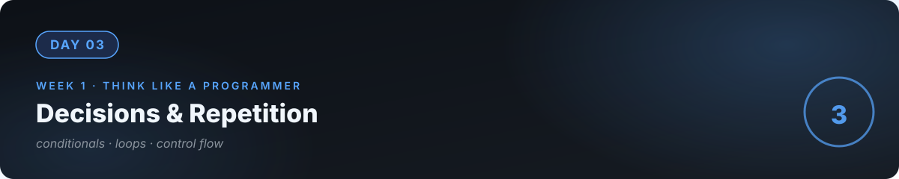

# 📘 Day 3 — Decisions & Repetition



**Concept:** `if` = decisions. Loops = repetition. Every app on earth — Instagram, banking, AI chatbots — is these two ideas composed at scale. Learn them deeply once, recognize them everywhere forever.

**Time:** ~60–90 minutes. **Rule:** explain the concept in plain words, or the day doesn't count.

---

## 1. Learn — the concept

### Decisions: `if / elif / else`

```python
temperature = 38

if temperature > 37:
    print("Fever — see a doctor.")
elif temperature > 36:
    print("Slightly warm — rest.")
else:
    print("Normal.")
```

The program **chooses a path** based on data. Key ideas:
- Conditions are True/False questions (that's the `bool` type from day 2).
- `elif` = "otherwise, if this…". `else` = "if nothing above matched."
- Indentation (the spaces) is how Python knows what belongs inside the decision. It matters.

Comparison operators you'll use constantly: `==` (equal), `!=` (not equal), `>` `<` `>=` `<=`. And combiners: `and`, `or`, `not`.

```python
if age >= 18 and has_id:
    print("Entry allowed.")
```

### Repetition: loops

**`while`** — repeat *until something changes*:
```python
tries = 0
while tries < 3:
    print("Trying...")
    tries = tries + 1   # if you forget this line, the loop NEVER ends
```

**`for`** — repeat *for each item*:
```python
for name in ["Ali", "Sara", "Bilal"]:
    print(f"Hello, {name}!")
```

### The two ideas together

```python
secret = 7
guess = 0

while guess != secret:          # repetition: keep going until correct
    guess = int(input("Guess: "))
    if guess < secret:          # decision: which hint?
        print("Higher...")
    elif guess > secret:
        print("Lower...")
    else:
        print("Correct!")
```

Read it out loud: "keep asking *while* the guess is wrong; *if* too low say higher…" — if you can narrate it, you own it.

### ⚠️ The classic trap: infinite loops

A `while` loop whose condition never becomes False runs **forever**. Every programmer does this once. When it happens: `Ctrl+C` stops it. Then ask: "what was supposed to change, and didn't?"

---

## 2. Specify — direct the AI

Write the spec **before** touching AI. Example:

> "Write a number guessing game: 1) computer picks a random number 1–100, 2) player guesses, gets 'higher'/'lower' hints, 3) counts tries and reports them at the end, 4) asks 'play again? (y/n)' and respects the answer, 5) if the player types a non-number, say so and don't count it as a try."

Give it to the AI. Then — critically — **check the game against YOUR spec**, rule by rule. Did it implement what you specified, or what it imagined?

## 3. Evaluate — be the senior

- Play it badly on purpose: type `abc`, type `9999`, type nothing, say `n` then `y`.
- For each surprise: was the *spec* incomplete, or did the AI misread it? Fix whichever was wrong.
- Ask the AI: "Show me where the loop could become infinite in this program, and what prevents it."
- Trace: if the secret is 42 and I guess 50, then 30, then 42 — which branches execute, in order?

## 4. Business lens 💼

"Play again? (y/n)" is a **retention loop** — the same pattern as "watch next episode?" Every business wants users to come back; loops in code mirror loops in business. And input validation ("don't count `abc` as a try") is **data quality** — garbage in, garbage out is a business problem, not just a code problem.

---

## 💻 Exercises

### Level 1
FizzBuzz, specified by you: "print 1–100; multiples of 3 → 'Fizz', of 5 → 'Buzz', of both → 'FizzBuzz'." AI builds; you verify all four cases appear.

### Level 2
A **password checker**: ask for a password, require 8+ characters AND at least one digit. Keep asking until valid. Specify the rules first — then check the AI enforced *your* rules.

### Level 3
**ATM simulator**: balance starts at 10,000. Loop a menu: 1) check balance 2) deposit 3) withdraw 4) exit. Withdraw more than balance → refuse with a message. Specify every rule (including: can balance go negative? what about non-number input?). Then be the QA engineer: try to break your own spec.

---

## ✅ Done when

- [ ] You can narrate any loop+if program out loud, branch by branch
- [ ] Your spec produced the game you imagined — you checked rule by rule
- [ ] You can explain what makes a loop infinite and how to stop one
- [ ] Committed to GitHub

## 📎 The one link

[Asabeneh — 30 Days of Python, Days 9–10](https://github.com/Asabeneh/30-Days-Of-Python) — conditionals and loops drills.

---

[← Day 2](../02_Day_Python_Variables_Types/) · [Day 4 →](../04_Day_Functions/)
