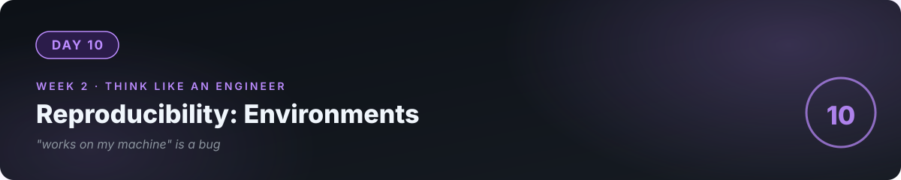

# 📘 Day 10 — Reproducibility: "Works on My Machine" Is a Bug



**Concept:** Software must run **elsewhere** — on a client's laptop, a server, a colleague's machine. A *virtual environment* is an isolated box of Python + packages for one project. `requirements.txt` is the **recipe** to rebuild that box anywhere. Without these, your software is a rumor; with them, it's real.

**Time:** ~60–90 minutes. **Rule:** explain the concept in plain words, or the day doesn't count.

---

## 1. Learn — the concept

### The problem

You `pip install requests` on your laptop. Your program works. You send it to a friend — **it crashes**: they don't have `requests`. Or they have version 1.0, you built against 2.31, and something subtle breaks. This is "dependency hell," and it has ended careers.

### The solution: isolated boxes + recipes

```bash
python -m venv .venv          # build an isolated box called .venv
source .venv/bin/activate     # step inside it (Windows: .venv\Scripts\activate)
pip install requests          # install ONLY inside the box
pip freeze > requirements.txt # write the recipe: exact packages + versions
```

- **venv** = your project's private Python. What you install here doesn't touch anything else on your system, and nothing else touches it.
- **requirements.txt** = the recipe. Anyone, anywhere: `pip install -r requirements.txt` → identical box.
- **The rule:** never `pip install` outside a venv. Global installs are how "it worked yesterday" mysteries begin.

### Why versions are pinned

`requirements.txt`:
```
requests==2.31.0
```

`==2.31.0` means *exactly* this version. Libraries change; today's update can break yesterday's code. Pinning says: "I built and tested against **this** — rebuild **this**." (Teams relax this later with ranges; pinned is correct for you now.)

---

## 2. Specify — direct the AI

> "My weather CLI from day 9 currently runs on my system Python. Walk me through: 1) creating a venv for it, 2) installing only what it needs inside the venv, 3) generating requirements.txt, 4) then PROVE it works by deleting the venv and rebuilding from the recipe in a fresh copy of the project folder. Explain each command before I run it — I need this in my fingers, not just done."

The proof step is the lesson. Anyone can follow install steps; **verifying from zero** is engineering.

## 3. Evaluate — be the senior

- After rebuilding from the recipe in a fresh folder: does `python weather.py` work first try? If not — **your recipe is the bug**, not the code. Fix the recipe.
- Run `pip list` inside the venv. For each package: what is it, and does your project actually need it? (If you can't justify it, it shouldn't be in the recipe.)
- Ask the AI: "Quiz me — what breaks if two projects share one global Python? What does 'activate' actually change? Why pin versions?"
- Check: is `.venv/` in your `.gitignore`? (It must be — the box is rebuilt from the recipe, never committed. Committing it is like mailing someone your kitchen instead of the recipe.)

## 4. Business lens 💼

A client can't use what they can't install. **"Just run these three commands"** (clone → venv → install → run) is the difference between a demo that impresses and a delivery that works. In freelance/contract work, the handover *is* the product — and reproducibility is what makes handovers clean. Docker (which you'll meet later) is this same idea, industrialized.

---

## 💻 Exercises

### Level 1
`pip list` in your venv. Write one line per package: what it does and why your project needs it. No line = no justification = remove it.

### Level 2
Write `setup.sh`: a script that takes a fresh clone from zero to running program (venv → install → run). Test it by actually cloning fresh. This script is gold — it's your project's **birth certificate**.

### Level 3
**Break it on purpose:** install a wrong version of `requests` in a scratch venv, run your weather CLI, observe the failure. Then fix by reinstalling from your pinned recipe. You've now *felt* dependency hell and its cure — you'll never skip pinning again.

---

## ✅ Done when

- [ ] You can explain venv vs global Python, and why recipes beat boxes, without notes
- [ ] Fresh folder + your recipe + your setup steps = working program, first try
- [ ] `.venv/` is gitignored; `requirements.txt` is committed
- [ ] Pushed to GitHub

## 📎 The one link

[Python docs — venv & pip](https://docs.python.org/3/tutorial/venv.html) — short, definitive.

---

[← Day 9](../09_Day_HTTP_APIs_JSON/) · [Day 11 →](../11_Day_OOP_Essentials/)
