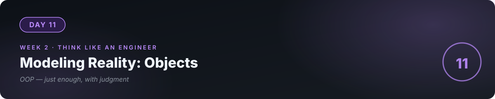

# 📘 Day 11 — Modeling Reality: Objects (Just Enough)



**Concept:** A class models a thing with **state** (data it holds) + **behavior** (things it can do). The real skill isn't syntax — it's **judgment**: when does a class earn its existence, and when is a plain function or dict better? Most OOP tutorials teach too much; you need just enough, plus the judgment.

**Time:** ~60–90 minutes. **Rule:** explain the concept in plain words, or the day doesn't count.

---

## 1. Learn — the concept

### The idea in one example

```python
class BankAccount:
    def __init__(self, owner, balance=0):
        self.owner = owner        # state: data this account HOLDS
        self.balance = balance

    def deposit(self, amount):    # behavior: things it can DO
        self.balance += amount

    def withdraw(self, amount):
        if amount > self.balance:
            return "Insufficient funds."
        self.balance -= amount
        return f"Withdrew {amount}."

acc = BankAccount("Mubashir", 10000)
acc.deposit(5000)
print(acc.balance)   # 15000
```

- `class BankAccount:` — the **blueprint**.
- `__init__` — the constructor: runs when you create one ("birth").
- `self` — "this specific account." `acc.deposit()` means: run `deposit` **on acc's data**.
- An **object** (`acc`) is the blueprint brought to life with its own state.

### The judgment: when is a class worth it?

| Use a class when… | Use a function/dict when… |
|---|---|
| The thing has **state that changes** over time (account balance, game player) | It's a one-shot computation (convert units) |
| Multiple **behaviors operate on the same data** | One behavior, no memory needed |
| You need **many independent copies** (100 accounts) | There's only ever one of it |

The test: **"Does this thing remember things between uses?"** If yes → class candidate. If no → function. Applying this test correctly is senior thinking; most over-engineering comes from skipping it.

### What you DON'T need today

Inheritance hierarchies, polymorphism lectures, design patterns — skip them. You'll recognize when you need them (roughly: when you catch yourself writing the same class three times with small differences). Today: state + behavior + the judgment test.

---

## 2. Specify — direct the AI

> "Refactor my expense tracker into classes: an Expense class (amount, category, note, date) and an ExpenseTracker class (holds the list, with add/list/totals_by_category/save/load methods). BUT first: argue the case — for each class, tell me what state it owns and why a dict + functions wouldn't be enough. If you can't make the case for a class, don't create it."

You're making the AI **defend its design before typing** — exactly the review you'd get (or give) in a real team.

## 3. Evaluate — be the senior

- For each class, answer: **what state does it own?** What breaks if that state were global instead?
- Create two trackers. Add an expense to one. Does the other change? (If yes — shared state bug, the classic OOP footgun. Understand *why*.)
- Ask the AI: "Show me one place in this refactor where a class was NOT worth it, and what you'd use instead." Then decide if you agree — **you're the judge**.
- The killer question: "What did classes buy me here that functions didn't?" If the answer is thin, that's a lesson too.

## 4. Business lens 💼

Over-engineering **costs clients real money** — every unnecessary class is code to write, test, and maintain. The most expensive sentence in software is "let's make it flexible for the future." Clients pay for software that solves *today's* problem cleanly and can evolve *when* needed, not for architecture astronautics. "Just enough" is a business skill.

---

## 💻 Exercises

### Level 1
`BankAccount` with deposit/withdraw/balance — then add `transaction_history` (a list of dicts — day 5 meets day 11). State + behavior, small and clean.

### Level 2
Model a **library book**: title, author, `is_borrowed` state, `borrow()`/`return_book()` behavior. Rule: can't borrow an already-borrowed book. Where does the rule live — in the method or outside? (Defend your choice.)

### Level 3
**The deletion exercise:** take your refactored tracker and delete one class, replacing it with functions + dicts. Does anything get *worse*? Write a paragraph: what did the class actually buy you? If the answer is "not much," you've learned the most valuable OOP lesson there is.

---

## ✅ Done when

- [ ] You can explain state vs behavior, and the "does it remember things?" test, without notes
- [ ] Every class in your refactor is defended — state owned, alternative considered
- [ ] You can explain `self` in one sentence
- [ ] Committed to GitHub

## 📎 The one link

[Corey Schafer — Python OOP series (YouTube)](https://www.youtube.com/@coreyms) — watch only what you need; you have the core already.

---

[← Day 10](../10_Day_Environments_Packages/) · [Day 12 →](../12_Day_Testing_Clean_Code/)
