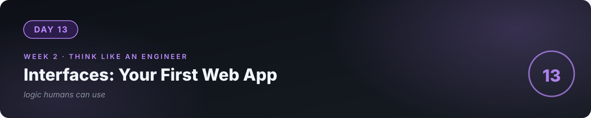

# 📘 Day 13 — Interfaces: Turning Logic Into Something Humans Use



**Concept:** Logic without an interface is **invisible**. A UI is just a translation layer: human intent in (clicks, typing), function calls out. Buttons call functions. Forms collect arguments. Charts display return values. Once you see this, every app demystifies: it's your day-4 functions wearing clothes.

**Time:** ~60–90 minutes. **Rule:** explain the concept in plain words, or the day doesn't count.

---

## 1. Learn — the concept

### The translation layer

Your expense tracker has `add_expense(amount, category, note)`. A web UI for it is:

- **Text box** → collects `amount` (an argument)
- **Dropdown** → collects `category` (an argument)
- **Button "Add"** → calls `add_expense(...)` with those arguments
- **Table/chart** → displays what the functions return

That's it. No new programming universe — **the same functions, new clothes.**

### Streamlit: Python → web page in minutes

```python
import streamlit as st

st.title("Expense Tracker")

amount = st.number_input("Amount", min_value=0.0)
category = st.selectbox("Category", ["Food", "Transport", "Bills", "Other"])
note = st.text_input("Note")

if st.button("Add expense"):
    add_expense(amount, category, note)   # YOUR day-7 function, unchanged
    st.success("Added!")

st.bar_chart(totals_by_category())       # YOUR function, visualized
```

Every `st.something` is a widget that **collects input or displays output**. Rerun model: when the user interacts, the script re-runs top to bottom with the new values. Simple mental model, enormously productive.

### The design insight

Good UI = **fewer decisions for the user**. Dropdown instead of free text (no typos in categories). Sensible defaults. One primary button. You'll evaluate your UI the same way you evaluate code: *watch a human use it*.

---

## 2. Specify — direct the AI

> "Build a Streamlit app (app.py) for my expense tracker. Reuse my existing functions — do NOT rewrite the logic, only the interface. Screens: 1) Add expense form (amount, category dropdown, note, date defaults today), 2) table of all expenses, 3) bar chart of totals by category. Rules: category must be a dropdown (no free text), amount can't be negative, show a success message on add. Keep logic and UI in separate sections of the file."

"Reuse my functions, don't rewrite the logic" — you're enforcing **separation of concerns**, a professional architecture instinct.

## 3. Evaluate — be the senior

- Run `streamlit run app.py`. Add an expense through the UI, then check: did it hit the *same* functions (and file) as the CLI? Two interfaces, one logic — verify it.
- **The silent user test:** hand it to a non-technical person. Zero explanation from you. Note every hesitation — each is a UI bug.
- Break it: negative amount, empty note, 100-character category via devtools (or just ask: what *can't* the UI prevent?). Where does validation live — UI, function, or both? (Answer: **both**. UI for kindness, functions for truth — because functions can be called from anywhere.)
- Ask the AI: "Quiz me — in this app, which parts are interface and which are logic? If I wanted a mobile app tomorrow, what would I reuse?"

## 4. Business lens 💼

**Clients don't buy code; they buy interfaces.** To a shop owner, your Python functions don't exist — the *screen* is the product. This is why "it works in the terminal" never closes a deal but "here, click around" does. The UI is also where **first impressions** form: a clean, working interface signals a professional builder before a word is spoken.

---

## 💻 Exercises

### Level 1
Add a **date picker** to the form (default: today). Verify the date flows into your existing function unchanged.

### Level 2
Add **CSV import**: upload a file of expenses, parse it, add each row. (Day-6 file skills + day-9 "data travels as text" — composition!)

### Level 3
**Two interfaces, one truth:** make the CLI and the web app share *one* functions file (import it in both). Prove it: add via CLI, see it in the web app. Then write the architecture in one paragraph: where does logic live, where does interface live, and why?

---

## ✅ Done when

- [ ] You can explain "UI = translation layer: widgets collect arguments, displays show return values" without notes
- [ ] A non-technical human used it with zero help from you
- [ ] Logic is shared between CLI and web (not duplicated)
- [ ] Committed to GitHub

## 📎 The one link

[Streamlit docs — Get Started](https://docs.streamlit.io/) — excellent, example-driven.

---

[← Day 12](../12_Day_Testing_Clean_Code/) · [Day 14 →](../14_Day_Project2_Deployed_Web_App/)
