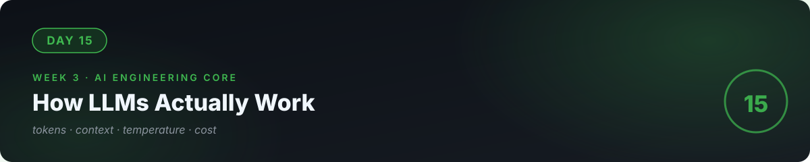

# 📘 Day 15 — How LLMs Actually Work (Practical)



**Concept:** An LLM is a **next-token prediction machine** trained on enormous text. You don't need the math — you need the *working model*: tokens (the unit of thought AND money), context window (working memory), temperature (randomness dial). Everything in weeks 3–4 hangs on these three ideas.

**Time:** ~60–90 minutes. **Rule:** explain the concept in plain words, or the day doesn't count.

---

## 1. Learn — the concept

### Next-token prediction

Given "The cat sat on the ___", the model predicts the most likely next word: "mat". Then it feeds "mat" back in and predicts the next. Repeat hundreds of times → a paragraph. **That's all generation is**: one likely token after another, very fast.

This explains *everything* about LLM behavior:
- It's confident even when wrong → it's predicting *likely* text, not *true* text.
- It "remembers" your conversation → the whole conversation is re-fed as input every turn.
- Prompt wording matters → different input, different likely continuations.

### Tokens: the unit of thought AND money

Text is chopped into **tokens** (~4 characters each in English; ~¾ of a word):

```
"AI engineering is fun"  →  ["AI", " engineering", " is", " fun"]  = 4 tokens
```

- You are **billed per token** (input + output).
- The model's **context window** (e.g., 128k tokens) is the max input+output it can consider at once — its working memory. Exceed it and the oldest content falls off.
- So: **tokens = cost**, **context = memory**. Every AI business decision touches these.

### Temperature: the randomness dial

- `temperature=0` → always picks the *most likely* token. Predictable, boring, reliable. Use for classification, extraction, code.
- `temperature=1` → samples from the likely tokens. Creative, varied, unpredictable. Use for brainstorming, writing.
- Most production work lives at **0–0.3**. Creativity is a bug when you want reliability.

### The API call (your first)

```python
from openai import OpenAI
client = OpenAI()  # reads OPENAI_API_KEY from environment

response = client.chat.completions.create(
    model="gpt-4o-mini",
    temperature=0,
    max_tokens=100,          # hard cap: cost control
    messages=[
        {"role": "system", "content": "You are a concise assistant."},
        {"role": "user", "content": "What does an AI engineer do?"},
    ],
)
print(response.choices[0].message.content)
print("tokens used:", response.usage.total_tokens)
```

Three roles: `system` (the instructions), `user` (the input), `assistant` (the replies). `max_tokens` caps cost. **Never hardcode API keys** — environment variables or `.env` (day 14's secret audit applies forever).

> Any provider works (Google AI Studio has a generous free tier). The concepts are identical; only the library name changes.

---

## 2. Specify — direct the AI

> "Write token_math.py: 1) a function estimate_cost(prompt_tokens, completion_tokens) using gpt-4o-mini pricing ($0.15 per 1M input tokens, $0.60 per 1M output — verify current pricing and note it may change), 2) a script that sends 3 prompts to the API, prints each response AND its token usage AND computed cost, 3) everything reads the API key from environment, failing with a clear message if missing."

You specified **cost observability** from your very first API call. That's engineering.

## 3. Evaluate — be the senior

- Run the same prompt at `temperature=0` three times, then at `temperature=1` three times. Describe the difference in one paragraph — that's your working definition of temperature.
- Set `max_tokens=5` on a long question. Watch it cut off mid-thought. That's what the cap does — now you *feel* it.
- **Do the business math:** 10,000 users × 5 messages/day × ~500 tokens/message. What's the monthly cost? Write the number down. (This number decides whether AI features are profitable — day 23 goes deep.)
- Ask the AI: "Quiz me — what happens to tokens 129,000+ in a 128k context window? Why does temperature=0 matter for a classifier?"

## 4. Business lens 💼

**Tokens are money.** Every AI product is token economics: *cost per user* vs *price per user*. A chatbot that costs $0.02/message needs either high prices or huge volume. Founders who can't do this math build products that lose money on every user — the most common AI startup death. You did the math on day 1 of touching models. That's the edge.

---

## 🧠 Quick check — do you own today?

<details>
<summary><b>Q1.</b> Why is an LLM confident even when it's wrong?</summary>

It predicts *likely* text, not *true* text. "Confident" is just high probability on the next token — truth was never the objective function.
</details>

<details>
<summary><b>Q2.</b> Your app's answers get weird on long conversations. What's probably happening?</summary>

The conversation is approaching the context window limit — oldest messages are falling out of working memory. Fix: summarize history, or retrieve only what's needed (day 19's RAG does exactly this).
</details>

<details>
<summary><b>Q3.</b> When do you want temperature=0 vs temperature=1?</summary>

0 for anything that must be reliable (classification, extraction, code, JSON). Higher for creative generation (brainstorming, marketing copy). Production defaults low.
</details>

---

## ✅ Done when

- [ ] You can explain next-token prediction, tokens, context window, and temperature to a non-technical friend
- [ ] Your script prints tokens used + cost for every call
- [ ] You've priced 10,000 users and written the number down
- [ ] API key in environment only; committed to GitHub

## 📎 The one link

[OpenAI API Quickstart](https://platform.openai.com/docs/quickstart) — or Google AI Studio if you want the free tier. Concepts identical.

---

[← Day 14](../14_Day_Project2_Deployed_Web_App/) · [Day 16 →](../16_Day_Prompt_Engineering/)
