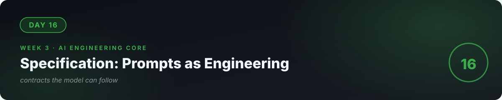

# 📘 Day 16 — Specification: Prompts as Engineering



**Concept:** A prompt is a **specification given to a probabilistic machine**. Vague specs → random output. Precise specs → reliable behavior. Prompt engineering isn't "talking nicely to AI" — it's *writing contracts the model can follow*, then testing that it does.

**Time:** ~60–90 minutes. **Rule:** explain the concept in plain words, or the day doesn't count.

---

## 1. Learn — the concept

### The anatomy of a reliable prompt

```
[ROLE]        You are a support-ticket classifier for a hardware store.
[TASK]        Read the ticket. Output ONLY valid JSON.
[FORMAT]      {"category": "<Billing|Technical|Delivery|Other>",
               "priority": "<Low|Medium|High>",
               "summary": "<one sentence>"}
[RULES]       - If unclear, category="Other", never guess.
              - Priority High only if the customer can't use the product.
[EXAMPLES]    Ticket: "My drill stopped working after 2 days"
              → {"category":"Technical","priority":"High","summary":"Drill failed after 2 days"}
[INPUT]       Ticket: "<<< ... >>>"
```

Each part has a job:
- **Role** → sets the model's "persona" and vocabulary.
- **Task** → what to do, precisely.
- **Format** → the *contract* for output (day 4's function contracts, for models).
- **Rules** → the edge cases, specified upfront (day 6's failure thinking).
- **Examples (few-shot)** → 2–3 demonstrations beat paragraphs of description. Models imitate patterns.
- **Delimiters** (`<<< >>>`) → mark where user input starts so it can't blur into instructions.

### Why this works

The model predicts likely continuations. A precise spec **narrows the space of likely outputs** to the ones you want. Examples are the strongest narrowing tool — the model copies the pattern, including the JSON shape.

### The iteration loop

1. Write the spec. 2. Test on 10 real inputs. 3. Find the failure. 4. Fix the *spec* (add a rule, add an example) — not the model. Repeat. **Prompt engineering is debugging specifications.**

---

## 2. Specify — direct the AI

> "I'm building a ticket classifier prompt. I will give you 5 example tickets; help me draft the system prompt following role/task/format/rules/examples structure. The output must be valid JSON with category, priority, summary. Then generate 10 tricky test tickets (ambiguous, angry, multi-issue, off-topic) for me to test against."

Note the meta-move: **you're using AI to help write the spec, then you'll evaluate the spec against tests.** The loop, applied to itself.

## 3. Evaluate — be the senior

- Run your 10 test tickets. Score: correct JSON? correct category? correct priority? Be strict.
- For each failure, decide: **was the spec vague, or was an example missing?** Fix exactly that. Re-run all 10 (regression — day 12's instinct).
- The reliability bar: **10/10, three runs in a row** (temperature=0). If it wavers, the spec isn't done.
- Try an **off-topic ticket** ("what's the weather?"). Does it follow your rules or improvise? Improvisation = spec gap.
- Ask the AI: "Quiz me — what does each part of my prompt do? What breaks if I remove the examples? The delimiters?"

## 4. Business lens 💼

**"Make it behave reliably" is what businesses pay for.** A classifier that's right 10/10 times automates a support queue; one that's right 7/10 creates *more* work than it saves. Reliability is the product — and reliability comes from specs + tests, not from a bigger model. When you scope AI work (day 26), "we'll prove 95%+ on 50 test cases" is the sentence that wins contracts.

---

## 🧠 Quick check — do you own today?

<details>
<summary><b>Q1.</b> Why do few-shot examples beat long descriptions?</summary>

Models imitate patterns. Two examples of exact input→output demonstrate the format, the tone, and the edge handling more precisely than paragraphs describing them.
</details>

<details>
<summary><b>Q2.</b> Your classifier works on 9/10 tickets. What's the correct next step?</summary>

Study the 1 failure, decide whether the spec was vague or an example was missing, fix the spec, re-run all 10. Never "just try a bigger model" first.
</details>

<details>
<summary><b>Q3.</b> What's the job of delimiters like &lt;&lt;&lt; &gt;&gt;&gt;?</summary>

They mark where untrusted user input begins and ends, so it can't blur into your instructions. It's the first, simplest defense against prompt injection (day 23).
</details>

---

## ✅ Done when

- [ ] Your classifier hits 10/10 on tricky tickets, 3 runs in a row, temperature=0
- [ ] You can explain what each part of your prompt does and what breaks without it
- [ ] You fixed failures by fixing the *spec*, and can show the before/after
- [ ] Committed to GitHub

## 📎 The one link

[Anthropic — Prompt Engineering Overview](https://docs.anthropic.com/en/docs/build-with-claude/prompt-engineering/overview) — the best single guide, provider-agnostic principles.

---

[← Day 15](../15_Day_LLMs_How_They_Work/) · [Day 17 →](../17_Day_Structured_Outputs_Tools/)
