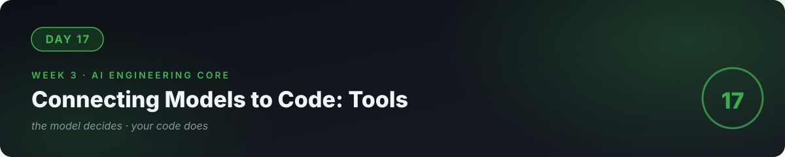

# 📘 Day 17 — Connecting Models to Code: Tools



**Concept:** **Tool calling** = the model decides *what* to do, your code does *how*. You give the model a menu of functions (with strict contracts — names, parameters, descriptions); it replies "call `calculate` with these arguments"; your code executes and returns the result; the model writes the final answer. The contract between them — the schema — is the engineering.

**Time:** ~60–90 minutes. **Rule:** explain the concept in plain words, or the day doesn't count.

---

## 1. Learn — the concept

### The loop, drawn

```
User: "What's 15% of 2400?"
  → Model thinks: "I need calculate(2400 * 0.15). I have that tool."
  → Model replies: {tool: "calculate", args: {expression: "2400*0.15"}}
  → YOUR code runs calculate("2400*0.15") → 360.0
  → Model writes: "15% of 2400 is 360."
```

The model never does math — it **delegates** to your code. This is the whole trick behind AI that "does things": the model is the brain, your functions are the hands.

### The contract (function schema)

```python
tools = [{
    "type": "function",
    "function": {
        "name": "calculate",
        "description": "Evaluate a math expression safely.",
        "parameters": {
            "type": "object",
            "properties": {
                "expression": {"type": "string",
                               "description": "e.g. '2400*0.15'"}
            },
            "required": ["expression"],
        },
    },
}]
```

The `description` fields are **read by the model** — they're part of your spec (day 16). Vague descriptions → wrong tool choices. This is prompt engineering applied to APIs.

### The three laws of tools

1. **Validate everything.** The model can send bad arguments. Check types, ranges, and safety *before* executing — never `eval()` raw model output.
2. **Tools do, models decide.** Keep tools small and honest: one job, clear name, predictable output.
3. **Log every call.** In production, "the AI called what with what?" must be answerable (day 25).

---

## 2. Specify — direct the AI

> "Build tool_calling_demo.py: 1) two tools — calculate(expression) using safe evaluation (ast module, NOT eval) and get_weather(city) calling the Open-Meteo API from day 9, 2) a loop: send user message + tool schemas to the model, if it requests a tool call, validate the arguments, execute, feed the result back, get the final answer, 3) print every step (model's tool request, your validation, the result) so the loop is visible, 4) max 3 tool calls per user message, then stop gracefully."

You specified the **protocol**, the **safety rules**, and the **stop condition**. That's the engineering.

## 3. Evaluate — be the senior

- Ask: "What's 15% of 2400?" → trace: did the model call `calculate` with the right expression? Did your validator accept it?
- Ask: "Weather in Lahore and Karachi?" → does it call the tool **twice** (parallel) or once? Either can be correct — understand which happened and why.
- **Attack your own validator:** get the model (or yourself, manually) to request `calculate` with `__import__('os').system('rm -rf /')`. Does your safe-evaluator refuse? If you used raw `eval`, you just learned why law #1 exists — fix it with `ast`.
- Break one link: make `get_weather` return an error. Does the loop handle it gracefully or crash? (Day 6's failure thinking, now in AI systems.)
- Ask the AI: "Quiz me — draw the full loop from memory. Who validates? Who executes? What stops infinite tool loops?"

## 4. Business lens 💼

Tools are how AI **touches real business systems** — databases, bookings, payments, inventory. "Chat with our data" demos are cute; "AI that checks stock, books the slot, and confirms by SMS" is what businesses pay for. Every tool you add is a new capability you can sell — and every tool is also a new thing to secure, which is why day 23 exists.

---

## 🧠 Quick check — do you own today?

<details>
<summary><b>Q1.</b> Who does the math in "What's 15% of 2400?" — the model or your code?</summary>

Your code. The model only decides *that* math is needed and *which* arguments to pass. Models predict text; tools do work.
</details>

<details>
<summary><b>Q2.</b> Why are the description fields in the schema so important?</summary>

The model reads them to decide when to call each tool. A vague description is a vague spec — the model will misroute calls, exactly like a human given unclear docs.
</details>

<details>
<summary><b>Q3.</b> What's the worst thing that happens if you skip argument validation?</summary>

The model can be tricked (or just mistaken) into destructive arguments — e.g., expression strings that execute system commands if you eval them raw. Validate before executing, always.
</details>

---

## ✅ Done when

- [ ] You can draw the full tool loop from memory and explain each arrow
- [ ] Your validator refuses a malicious expression (tested, not assumed)
- [ ] Every tool call is logged with arguments and results
- [ ] Committed to GitHub

## 📎 The one link

[OpenAI — Function Calling Guide](https://platform.openai.com/docs/guides/function-calling) — the protocol reference; concepts transfer to every provider.

---

[← Day 16](../16_Day_Prompt_Engineering/) · [Day 18 →](../18_Day_Embeddings_Semantic_Search/)
