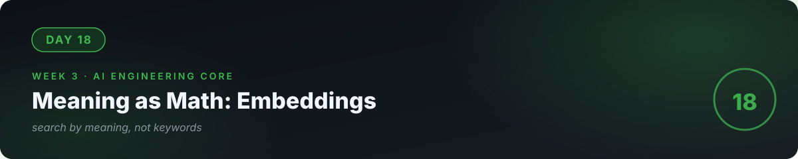

# 📘 Day 18 — Meaning as Math: Embeddings



**Concept:** An **embedding** turns text into a list of numbers (a vector) where **similar meanings → similar vectors**. Once meaning is math, you can *search by meaning* instead of by keywords. "How do I reset my password?" finds "Password recovery instructions" even with zero shared words. That leap powers everything in days 19–21.

**Time:** ~60–90 minutes. **Rule:** explain the concept in plain words, or the day doesn't count.

---

## 1. Learn — the concept

### From words to vectors

```python
embed("dog")  → [0.21, -0.83, 0.55, ...]   # ~1500 numbers
embed("puppy") → [0.19, -0.80, 0.58, ...]   # very close
embed("tax law") → [-0.44, 0.12, -0.91, ...]  # far away
```

Closeness is measured by **cosine similarity** — the angle between two vectors. Small angle = similar meaning. That's the entire ranking algorithm: embed the query, embed every document, return the documents with the smallest angle.

### Why this beats keyword search

Keyword search: "refund policy" won't match "how to get your money back." Embedding search: both live in the same *neighborhood of meaning* → it matches. The model's training learned which texts mean similar things; the vector is that knowledge, frozen as numbers.

### The properties that matter for engineering

- **Dimensions**: ~768–3072 numbers per text. More = finer distinctions, more storage/compute.
- **Not reversible**: you can't recover the text from the vector — but don't treat vectors as encrypted secrets either.
- **Model-specific**: vectors from model A can't be compared with vectors from model B. Pick one embedding model per system and never mix.
- **Cost**: embedding is cheap (a fraction of generation cost) — but at millions of documents, it adds up. (Day 23's unit economics.)

---

## 2. Specify — direct the AI

> "Build semantic_search.py: 1) take a list of 20 FAQ strings about a fictional shop (returns, hours, warranty, shipping…), 2) embed them all with the embeddings API and cache the vectors in a local JSON file (embeddings_cache.json) so re-runs don't re-pay, 3) function search(query, top_k=3) that embeds the query and returns the 3 most similar FAQs by cosine similarity — implement cosine yourself with math, no library, 4) a demo comparing keyword search vs semantic search on 3 tricky queries (synonyms, typos, indirect phrasing)."

You specified **caching** (cost discipline) and **implementing the math yourself** (concept ownership). Both matter.

## 3. Evaluate — be the senior

- The 3 tricky queries: does semantic search win all 3? For each, explain *why* keywords failed — that's the concept talking.
- Delete the cache file and re-run. Does it rebuild? Now run again — does it reuse the cache? (Reproducibility + cost, from days 6 and 10.)
- **Adversarial check:** search "how do I hack this system?" against your shop FAQs. The top result is probably irrelevant — notice that **similarity ≠ relevance judgment**. Returning the closest vector is not the same as answering safely. Day 23 will arm this.
- Ask the AI: "Quiz me — what is cosine similarity measuring, intuitively? Why must I never mix embedding models? Why cache embeddings?"

## 4. Business lens 💼

Semantic search is the cheapest AI feature with the highest perceived magic: help centers, product search, knowledge bases, resume screening. It turns "our docs are unsearchable" into a working product in a day. When scoping (day 26), "semantic search over your existing documents" is the fastest credible AI win you can offer a client — and today's cache file is the difference between a demo and a *profitable* deployment.

---

## 🧠 Quick check — do you own today?

<details>
<summary><b>Q1.</b> In one sentence: what is an embedding?</summary>

Text converted to a list of numbers where similar meanings produce similar numbers — so meaning can be compared with math.
</details>

<details>
<summary><b>Q2.</b> Why can't you compare vectors from two different embedding models?</summary>

Each model has its own private "map" of meaning. Coordinates on one map are meaningless on another. One model per system, no mixing.
</details>

<details>
<summary><b>Q3.</b> Your search returns the closest FAQ, but it's a bad answer to the question. What went wrong?</summary>

Nothing "went wrong" — cosine similarity finds the nearest meaning, not a correct or safe answer. Retrieval is step one; judging and grounding the answer is the next engineering (day 19's RAG).
</details>

---

## ✅ Done when

- [ ] You can explain embeddings and cosine similarity to a non-technical friend
- [ ] Semantic search beats keyword search on all 3 tricky queries, with reasons
- [ ] Embeddings cached locally; re-runs don't re-pay
- [ ] Committed to GitHub

## 📎 The one link

[OpenAI — Embeddings Guide](https://platform.openai.com/docs/guides/embeddings) — short, practical, concepts transfer everywhere.

---

[← Day 17](../17_Day_Structured_Outputs_Tools/) · [Day 19 →](../19_Day_RAG/)
