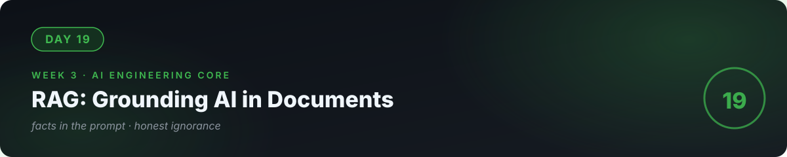

# 📘 Day 19 — RAG: Grounding AI in Real Documents



**Concept:** **RAG (Retrieval-Augmented Generation)** = don't ask the model to *remember* your documents — **fetch the relevant chunks and put them in the prompt**. This fixes the two biggest LLM flaws at once: hallucination (it now has the facts in front of it) and stale knowledge (your documents, not its training data). Most "AI over our data" products are RAG.

**Time:** ~60–90 minutes. **Rule:** explain the concept in plain words, or the day doesn't count.

---

## 1. Learn — the concept

### The pipeline, drawn

```
1. INDEX (once):       docs → split into chunks → embed each chunk → store vectors
2. RETRIEVE (per q):   question → embed → find top-k similar chunks (day 18!)
3. GENERATE (per q):    prompt = system instructions + retrieved chunks + question
                       → model answers USING the chunks
```

### Why each step exists

- **Chunking** (e.g., 500 tokens with overlap): whole documents don't fit context windows, and one giant vector buries the relevant sentence. Chunks are the unit of retrieval. Too big → noisy; too small → loses context. Overlap (~50 tokens) prevents cutting sentences in half.
- **The grounding instruction**: "Answer ONLY from the provided context. If the answer isn't in the context, say you don't know." This is the anti-hallucination contract — day 16's spec discipline applied to generation.
- **"I don't know" is a feature**: a RAG system that admits ignorance is trustworthy; one that invents answers is a liability.

### The failure modes (know them before you ship)

| Failure | Symptom | Fix |
|---|---|---|
| Bad chunks | Retrieved text is cut mid-thought | Smaller chunks, more overlap |
| Missed retrieval | Right doc exists, not retrieved | Better chunking, hybrid search |
| Ignored context | Model answers from training, not docs | Stronger grounding instruction, lower temperature |
| Fabricated citation | Confident answer, docs don't support it | "Say you don't know" rule + evals (day 22) |

---

## 2. Specify — direct the AI

> "Build rag_demo.py: 1) index 5 text files (write 5 short docs yourself: shop policies, product specs — keep each under 800 words so chunking is visible), chunk at ~400 tokens with 50-token overlap, embed and cache, 2) ask(question): retrieve top-3 chunks, build the grounded prompt with the anti-hallucination instruction, call the model at temperature=0, 3) print the retrieved chunks AND the answer so grounding is inspectable, 4) test with 3 questions: one answerable, one partially answerable, one completely unanswerable from the docs."

You specified **inspectability** (print the chunks) and **the unanswerable test** — the two things that separate real RAG from a demo.

## 3. Evaluate — be the senior

- The unanswerable question: did it say "I don't know" or invent something? If it invented, strengthen the instruction and re-test. **This test decides whether your system is trustworthy.**
- The partially answerable one: does it answer only the supported part and decline the rest? Partial honesty is the bar.
- **Retrieval quality:** for each question, are the top-3 chunks actually the right ones? If the answer was right but the chunks were wrong, you got lucky — fix chunking, don't celebrate.
- Swap in a trick: ask about something in the docs but phrased with synonyms (day 18's strength should carry you). Then ask something *similar-sounding but different*. Watch the boundary.
- Ask the AI: "Quiz me — draw the RAG pipeline from memory. Why chunk? Why 'I don't know' is a feature? What are the 4 failure modes?"

## 4. Business lens 💼

**"Chat with our documents" is the #1 requested AI feature in small businesses** — support docs, policy manuals, product catalogs. RAG delivers it without fine-tuning (expensive, brittle). Your pricing story: a fixed setup fee + per-query cost you can compute from today's token math. And the "says I don't know" behavior is what makes a business *trust* it with customers — reliability is the product (day 16's lesson, again).

---

## 🧠 Quick check — do you own today?

<details>
<summary><b>Q1.</b> Why does RAG reduce hallucination?</summary>

The facts are placed in the prompt, so the model predicts continuations of *your documents* instead of its training data. Combined with "answer only from context," fabrication drops sharply.
</details>

<details>
<summary><b>Q2.</b> Your RAG answers correctly but cites the wrong chunk. Is that fine?</summary>

No — right answer, wrong retrieval means you got lucky. Retrieval quality is the system's foundation; fix chunking or ranking before it fails on a question you didn't test.
</details>

<details>
<summary><b>Q3.</b> When is RAG the wrong choice vs fine-tuning?</summary>

RAG wins when knowledge changes (docs update without retraining) and when you need citations. Fine-tuning is for behavior/style, not for memorizing facts — and it's far more expensive to maintain.
</details>

---

## ✅ Done when

- [ ] You can draw the RAG pipeline from memory and explain each step's purpose
- [ ] The unanswerable question gets an honest "I don't know"
- [ ] Retrieved chunks are printed and you've verified they're the *right* chunks
- [ ] Committed to GitHub

## 📎 The one link

[Pinecone — RAG Guide](https://www.pinecone.io/learn/retrieval-augmented-generation/) — the clearest single explainer of the pattern and its failure modes.

---

[← Day 18](../18_Day_Embeddings_Semantic_Search/) · [Day 20 →](../20_Day_Agents/)
