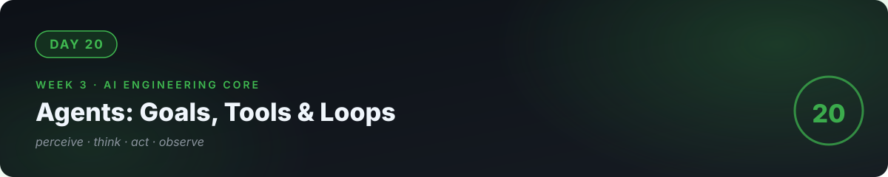

# 📘 Day 20 — Agents: Goals, Tools & the Perceive–Act Loop



**Concept:** An **agent** = an LLM in a **loop**: *perceive* (read the goal + current state) → *think* (decide the next step) → *act* (call a tool) → *observe* the result → repeat until the goal is done or a limit hits. Tools (day 17) were single calls; agents are the model **choosing its own sequence of calls** to reach a goal. Powerful, and the hardest thing here to keep safe.

**Time:** ~60–90 minutes. **Rule:** explain the concept in plain words, or the day doesn't count.

---

## 1. Learn — the concept

### The loop, drawn

```
Goal: "Book me the cheapest flight option summary for Friday"

Loop (max 8 steps):
  1. THINK: "I need flight options → I have search_flights tool"
  2. ACT:   search_flights(day="Friday")
  3. OBSERVE: got 6 options
  4. THINK: "Cheapest is option 3 → summarize"
  5. ACT:   (no tool needed) write summary
  6. DONE
```

The model's "thinking" is just more token prediction — but framed as planning, it produces step-by-step behavior. The **system prompt carries the rules**: what tools exist, when to stop, what never to do.

### The three things that make agents work

1. **A sharp goal + stop conditions.** "Research X and summarize" works. "Do something useful" doesn't. Always: max steps, and a clear definition of done.
2. **Honest tools with clear descriptions** (day 17). The agent is only as capable as its tools are legible.
3. **Scratchpad memory.** The agent keeps its running notes ("tried X, got Y, next: Z") in the conversation — this is how multi-step plans survive.

### The three things that make agents dangerous

1. **No natural stop.** Without step limits, an agent can loop, burn tokens, or hammer APIs. **Always cap steps and cost.**
2. **Tool power = damage it can cause.** An agent with "send_email" and "delete_file" tools can do real damage from a misread instruction. Give the *minimum* tools for the goal.
3. **Confident wrongness compounds.** One bad tool call → the agent plans around the bad result → confidently wrong final answer. Human checkpoints on consequential actions.

---

## 2. Specify — direct the AI

> "Build research_agent.py: 1) a loop with max 6 steps: each step the model gets the goal, its scratchpad so far, and two tools — search_web(query) (use a simple DuckDuckGo/HTTP approach or a stub you write returning canned results for the demo) and save_note(text) (appends to notes.md), 2) system prompt: 'You are a research assistant. Work step by step. After each tool result, update your plan. Stop when you can answer the goal or hit 6 steps. Never invent tool results., 3) run it on: 'What are 3 free ways to deploy a Python web app in 2026?', 4) print every think/act/observe step."

You specified **the loop, the cap, the honesty rule, and full traceability**. That's agent engineering.

## 3. Evaluate — be the senior

- Read the full trace. Did each step follow from the previous observation, or did it jump? A good agent's trace reads like a plan; a bad one's reads like guessing.
- **Break the stop condition:** temporarily set max steps to 2. Does it stop gracefully and report partial results, or crash? Limits must be *handled*, not just set.
- **Test the honesty rule:** give it a goal your stubbed search can't answer. Does it admit the gap, or invent results? (Day 19's "I don't know" — now for agents.)
- Count tokens used for the whole run. Multiply by your day-15 pricing. **An agent run costs 5–20× a single call** — write the number down. (This is day 23's preview: agents are expensive; the business must justify it.)
- Ask the AI: "Quiz me — draw the agent loop from memory. What are the 3 things that make agents work and the 3 that make them dangerous?"

## 4. Business lens 💼

Agents are the most **oversold** and most **misunderstood** AI capability. Clients will ask for "an AI agent that does everything." Your job (day 26) is to scope: *which* goal, *which* tools, *what* stop conditions, *whose* approval for consequential actions, *what* it costs per run. An agent with a tight goal, 3 tools, and a human checkpoint is a product. An agent with vague goals and a credit card is a liability. Knowing the difference is what makes you the engineer in the room.

---

## 🧠 Quick check — do you own today?

<details>
<summary><b>Q1.</b> What's the difference between tool calling (day 17) and an agent?</summary>

Tool calling: the model makes one delegated call you orchestrate. An agent: the model runs a perceive–think–act–observe loop, choosing its own sequence of tool calls until the goal is done or a limit hits.
</details>

<details>
<summary><b>Q2.</b> Name two non-negotiable safety rules for any agent you build.</summary>

Cap steps (and cost) with graceful stopping; give minimum-necessary tools; require human approval for consequential actions. Any two of these.
</details>

<details>
<summary><b>Q3.</b> Your agent's trace shows it invented a tool result instead of calling the tool. What's the root cause and fix?</summary>

The system prompt didn't enforce honesty, or the model wasn't given a way to say "I can't." Fix: explicit "never invent tool results" rule + a defined fallback (report the gap and stop).
</details>

---

## ✅ Done when

- [ ] You can draw the agent loop from memory and explain each part
- [ ] Your agent stops gracefully at the step cap with partial results
- [ ] You've priced a full agent run and written the number down
- [ ] Committed to GitHub

## 📎 The one link

[Anthropic — Building Effective Agents](https://www.anthropic.com/engineering/building-effective-agents) — the field's best practical guide; short and opinionated.

---

[← Day 19](../19_Day_RAG/) · [Day 21 →](../21_Day_Project3_RAG_Chatbot/)
