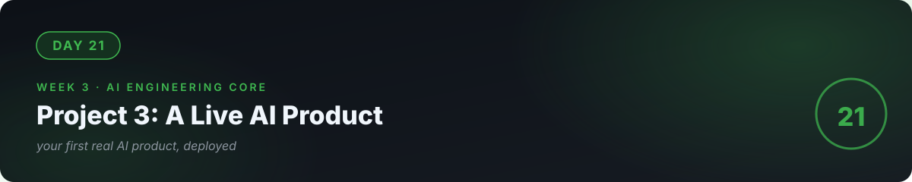

# 🛠️ Day 21 — Project 3: A Live AI Product ⭐ Milestone

**Today you ship your first real AI product:** a RAG chatbot over real documents, deployed to a live URL. This is the Week 3 proof — and the template for the kind of thing businesses actually buy.

**Time:** 2–3 hours. **Scope:** tight. One chatbot, one document set, live URL. **Done when strangers can use it.**

---

## The mission

**Build and deploy "AskMyDocs"** — a chatbot that answers questions from a real document collection, with sources shown, "I don't know" when it can't, and a live public URL.

### Suggested document set (pick one)

- A local business's public FAQs/policies (with permission)
- Public documentation of an open-source tool you like
- Your own notes from days 15–20 (delightfully meta)

---

## The spec (write this before touching code)

Your README for the project must answer:

1. **What it does:** "Answers questions about X documents; shows sources; admits ignorance."
2. **Architecture:** Streamlit UI → retrieve (embeddings) → grounded prompt → model → answer + sources. Draw the diagram (day 19's pipeline).
3. **Reliability contract:** temperature=0; "answer only from context"; top-3 chunks shown with every answer.
4. **Cost model:** tokens per question (measured), estimated monthly cost at 100 questions/day. Write the number.
5. **Known limits:** "Fails gracefully on unanswerable questions; no real-time data; English only."

---

## The build (your call on order)

- [ ] Index pipeline: chunk → embed → cache (days 18–19, reused)
- [ ] Streamlit chat UI (day 13's patterns): question box, answer, expandable "sources" showing the retrieved chunks
- [ ] The honesty test: 3 unanswerable questions → all get "I don't know"
- [ ] 10-question eval set: run it, score it, fix the worst failure (day 22's instinct, early)
- [ ] Secrets in `.env`/Streamlit secrets, never in code (day 14's audit, again)
- [ ] Deploy to Streamlit Cloud → **live URL**
- [ ] Project README with the spec above + the URL + the cost model

## The senior review (do this before calling it done)

- [ ] Ask it something it can't know → honest "I don't know"? (If not, you're not done.)
- [ ] Check the sources panel → are the chunks actually relevant?
- [ ] Open the URL in incognito → works for a stranger?
- [ ] Read your cost model → could this survive real usage without losing money?
- [ ] Show it to one real person. Watch them use it. Write down what confused them.

---

## 🧠 Milestone check — Week 3

<b>Q1.</b> Explain your chatbot's full pipeline in 60 seconds.

Index (chunk → embed → cache) → per question: embed → retrieve top-3 → grounded prompt → model answers from context only → show answer + sources. Temperature 0, "I don't know" when unsupported.

<b>Q2.</b> What's the single most important behavior you tested?

Honest ignorance. A chatbot that admits what it doesn't know is trustworthy; one that invents answers is a liability you shipped to the public.

<b>Q3.</b> What's your cost per 100 questions, and why does it matter?

Your measured number. It matters because it decides pricing: if each question costs $0.01 and you charge nothing, 10k questions cost you $100. Token economics or the business dies.

---

## ✅ Done when

- [ ] Live URL works for a stranger in incognito
- [ ] Sources shown with every answer; "I don't know" tested and passing
- [ ] Project README has spec, cost model, known limits, and the URL
- [ ] Committed; URL shared with at least one real person

## 📎 The one link

[Streamlit — Build a Chatbot](https://docs.streamlit.io/develop/tutorials/llms/build-conversational-apps) — the official chat UI pattern you'll build on.

---

**You now have three shipped projects: a CLI tool, a live web app, and a live AI product.** Week 4 is about making all of this *production-grade and sellable*.

[← Day 20](../20_Day_Agents/) · [Day 22 →](../22_Day_Evals/)
