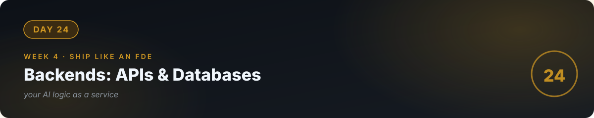

# 📘 Day 24 — Backends: APIs & Persistence



**Concept:** Streamlit is a demo vehicle; **real products need a backend**: an API (FastAPI) that serves your AI logic to any client — web, mobile, WhatsApp — and a **database** (SQLite/Postgres) that remembers users, conversations, and usage. Today your RAG chatbot grows a spine: HTTP in, answers out, everything recorded.

**Time:** ~60–90 minutes. **Rule:** explain the concept in plain words, or the day doesn't count.

---

## 1. Learn — the concept

### Why a backend

```
Before:  Streamlit app (UI + logic glued together, one user at a time)
After:   FastAPI server ← HTTP → any client (web/mobile/bot)
              ↓
         Database (users, conversations, token usage)
```

The API is a **contract** (day 4's idea, at system scale): `POST /ask {"question": "..."}` → `{"answer": "...", "sources": [...], "tokens_used": 412}`. Any client can use it. Your AI logic becomes a *service*.

### FastAPI in 20 lines

```python
from fastapi import FastAPI
from pydantic import BaseModel

app = FastAPI()

class AskRequest(BaseModel):
    question: str          # validated automatically: must be a string

class AskResponse(BaseModel):
    answer: str
    sources: list[str]
    tokens_used: int

@app.post("/ask", response_model=AskResponse)
def ask(req: AskRequest):
    # your RAG pipeline from day 19 goes here
    ...
```

**Pydantic models are contracts**: bad input gets rejected with a clear error before your code ever sees it. This is validation (day 17's law #1) built into the framework.

### The database: memory that survives restarts

SQLite (a single file, zero setup) is perfect now; Postgres later when you scale. One table to start:

```sql
CREATE TABLE interactions (
    id INTEGER PRIMARY KEY,
    timestamp TEXT,
    question TEXT,
    answer TEXT,
    tokens_used INTEGER,
    was_refusal BOOLEAN
);
```

Every answer your API gives gets recorded. That table **is** your usage billing, your eval data (day 22), and your debugging history (day 25) — one table, three jobs.

---

## 2. Specify — direct the AI

> "Convert my RAG chatbot to a FastAPI backend: 1) POST /ask with Pydantic request/response models including tokens_used, 2) every interaction logged to SQLite with timestamp, question, answer, tokens, refusal flag, 3) GET /stats returning total questions, total tokens, total estimated cost, refusal rate — computed from the DB, 4) keep the Streamlit UI but make it call the API instead of the pipeline directly, 5) run with uvicorn; document the endpoints in the README."

You specified **the contract, the logging, and the stats** — the three things that make a backend production-shaped.

## 3. Evaluate — be the senior

- `curl` the API directly (no UI). Bad input (`{"question": 123}`) → clean 422 error, not a crash? Contracts hold?
- Ask 5 questions through the UI, then check `/stats` and query the DB directly. Do the numbers match? **Your billing depends on this table being right.**
- Kill the server mid-answer (Ctrl+C). Restart. Is the history intact? (That's the point of the database.)
- Load test lightly: 20 rapid requests. Does anything break? (You don't need perfection — you need to *know* the limit.)
- Ask the AI: "Quiz me — why does a backend beat Streamlit-only for real products? What do Pydantic models guarantee? What three jobs does the interactions table do?"

## 4. Business lens 💼

**An API turns your AI work into something businesses can buy and integrate.** "Here's your endpoint and docs" beats "here's a demo link" — it plugs into *their* systems (their website, their WhatsApp, their internal tools). And the interactions table is your business intelligence: which questions are asked most (→ new features), what it costs per client (→ pricing), where it refuses (→ doc gaps to fix, billable work). The backend isn't just servers and setup — it's the business.

---

## 🧠 Quick check — do you own today?

<details>
<summary><b>Q1.</b> What does a Pydantic model guarantee at your API boundary?</summary>

That incoming data matches the contract (types, required fields) — invalid requests are rejected with clear errors before touching your logic. Validation at the border.
</details>

<details>
<summary><b>Q2.</b> Why log every interaction to the database?</summary>

One table serves three jobs: usage billing (tokens per client), eval data (real questions to test against), and debugging history (what happened when something went wrong).
</details>

<details>
<summary><b>Q3.</b> A client asks "can our mobile app use your chatbot?" — what changed by having a backend?</summary>

Nothing needs rebuilding: the API contract already serves any HTTP client. That's the whole point — the AI logic is a service now, not a demo page.
</details>

---

## ✅ Done when

- [ ] You can explain backends, API contracts, and the DB's three jobs in plain words
- [ ] `/ask` works via curl; bad input gets clean errors; `/stats` matches the DB
- [ ] Streamlit UI calls the API; history survives a restart
- [ ] Committed to GitHub

> 🔭 **Coming back to this:** [Phase 2, weeks 1–2](../31_Phase2_Build_Like_An_Engineer/) rebuilds everything you touched today — Postgres with migrations, a documented API strangers can use. Today you met the backend. There, you'll own it.

## 📎 The one link

[FastAPI Tutorial — First Steps](https://fastapi.tiangolo.com/tutorial/first-steps/) — the official tutorial; you'll use the first half today.

---

[← Day 23](../23_Day_Guardrails_Cost/) · [Day 25 →](../25_Day_Observability_Debugging/)
