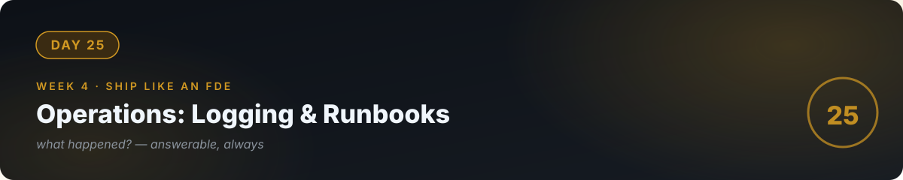

# 📘 Day 25 — Operations: Logging, Tracing & Runbooks



**Concept:** Code you can't observe is code you can't run. **Observability** = the ability to answer "what happened?" from your logs and metrics — every request logged, every AI call traced (tokens, latency, cost), key numbers aggregated. And a **runbook** = the written "when X breaks, do Y" so 2am-you (or your client) doesn't have to think from scratch.

**Time:** ~60–90 minutes. **Rule:** explain the concept in plain words, or the day doesn't count.

---

## 1. Learn — the concept

### The three pillars (practical version)

1. **Logs** — "what happened, in order." Every request: timestamp, question (or its hash, for privacy), retrieved chunks, tokens, latency, errors. Structured (JSON) beats prose — machines can search JSON.
2. **Metrics** — "how are we doing, in numbers." Requests/min, error rate, avg tokens/answer, cost/hour, refusal rate. One dashboard, five numbers.
3. **Traces** — "follow one request through the system." Question → retrieval (which chunks, how long) → model call (tokens, latency) → response. When an answer is bad, the trace shows *which step* failed.

### What to log for AI systems (the checklist)

- [ ] Input (or hash) + timestamp + user/session id
- [ ] Retrieved chunk IDs (so you can replay retrieval)
- [ ] Model, temperature, tokens in/out, latency
- [ ] Final answer + refusal flag
- [ ] Every tool call: name, arguments, result, duration (day 17's law #3)
- [ ] Every error with full context

### Runbooks: operations as code

```markdown
## Runbook: costs spiking
Symptom: cost/hour > $X (alert fires)
1. Check /stats: which user/session is driving volume?
2. Check logs: legit traffic or abuse? (huge inputs? rapid-fire?)
3. If abuse: block the source, keep the logs.
4. If legit: raise the cap temporarily, notify the client, re-price.
5. Post-mortem: why didn't the cap catch it?
```

Write runbooks for your **top 3 failure modes** before you need them. Writing them forces you to decide the response while calm.

---

## 2. Specify — direct the AI

> "Add observability to my FastAPI backend: 1) structured JSON logging for every /ask request covering the AI checklist above (log to app.log), 2) extend /stats with avg latency, error rate, cost per hour, top 5 most-asked question patterns, 3) write RUNBOOK.md with 3 runbooks: cost spike, bad answers reported, API down — each with symptoms, diagnosis steps, fixes, and when to escalate to me, 4) a simple alerts script that reads the log and prints a warning if cost/hour exceeds my configured threshold."

You specified **the checklist, the runbooks, and the alert** — operations, not just code.

## 3. Evaluate — be the senior

- **The replay test:** pick a bad answer from the log. Using only the log, can you reconstruct exactly what happened (which chunks, what tokens)? If yes, your observability works. If no, add what's missing.
- Trigger your cost alert with a tiny threshold. Does it fire? An alert you've never seen fire is a hope, not a system.
- Hand your RUNBOOK.md to someone (or your AI) and roleplay: "costs are spiking, follow the runbook." Where do they get stuck? Fix the runbook.
- Ask the AI: "Quiz me — what are logs, metrics, traces in one line each? What's on the AI logging checklist? Why write runbooks before incidents?"

## 4. Business lens 💼

**Observability is what lets you *sell* reliability.** "We monitor cost, latency, and answer quality continuously, with runbooks for the top failure modes" — that sentence is worth money in every client conversation. It's also your maintenance product: monthly reports from /stats ("your users asked X, it cost Y, we fixed Z") justify a retainer. Unobserved systems fail silently; observed systems fail *noisily and fixably* — and clients pay for the difference.

---

## 🧠 Quick check — do you own today?

<details>
<summary><b>Q1.</b> A client reports "the chatbot gave a wrong answer yesterday." What's your first move?</summary>

The logs: find the request, read the trace — which chunks were retrieved, what the model was given. The trace tells you whether retrieval, grounding, or data was at fault. No guessing.
</details>

<details>
<summary><b>Q2.</b> Why JSON logs instead of plain text?</summary>

Structure makes logs searchable and aggregatable by machines — you can compute cost/hour, filter by user, replay requests. Prose logs are write-only.
</details>

<details>
<summary><b>Q3.</b> What's a runbook, and why write it before anything breaks?</summary>

A written "when X breaks, do Y." Writing it calm forces clear decisions; following it during an incident prevents panic-driven mistakes. It's operations as code.
</details>

---

## ✅ Done when

- [ ] You can explain logs/metrics/traces and the AI logging checklist
- [ ] The replay test passes: a past bad answer is fully reconstructable from logs
- [ ] RUNBOOK.md has 3 tested runbooks; the cost alert fires
- [ ] Committed to GitHub

## 📎 The one link

[Google SRE Book — Monitoring](https://sre.google/sre-book/monitoring-distributed-systems/) — the definitive chapter on what to monitor and why; skim for principles.

---

[← Day 24](../24_Day_FastAPI_Databases/) · [Day 26 →](../26_Day_Client_Discovery_FDE/)
