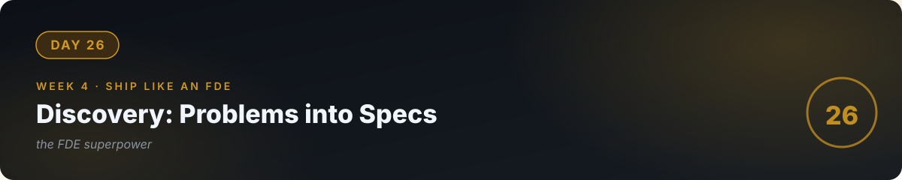

# 💼 Day 26 — Discovery: Turning Human Problems into Specs



**Concept:** The FDE's superpower isn't code — it's **discovery**: walking into a business, finding the problem worth solving, and turning human complaints into a **scoped, priced, buildable spec**. Most "AI projects" fail here, before a line is written: wrong problem, vague scope, no buyer. Today you learn the conversation that prevents all three.

**Time:** ~60–90 minutes. **Rule:** explain the concept in plain words, or the day doesn't count.

---

## 1. Learn — the concept

### The discovery conversation (45 minutes, 5 questions)

You're not selling. You're diagnosing. Ask:

1. **"Walk me through your week. Where does time go?"** — Find the pain in *their* words. Listen for repetition: "every Monday I…", "we always have to…"
2. **"What does that cost you?"** — Time × people × frequency. "3 hours every day" = the budget for your solution. No cost = no project.
3. **"What have you tried?"** — Respects their effort; reveals constraints ("we tried software X, too complicated").
4. **"Who else feels this pain?"** — One person annoyed = favor. A team slowed = budget.
5. **"If this were fixed, what would change?"** — The success metric, in their words. This becomes your eval (day 22).

**Never pitch in the discovery meeting.** Diagnose, quantify, leave. The proposal comes later — and it's 10× stronger for it.

### The business brief (one page, your deliverable)

```markdown
# Business Brief: [Client] — [Problem]
Problem: [one paragraph, their words]
Cost of problem: [hours/week × people = $/month]
Proposed solution: [2-3 sentences, no jargon]
Scope: [what's IN — 3 bullets] / [what's OUT — 3 bullets]
Success metric: [measurable, their words from Q5]
Timeline: [e.g., 2 weeks]   Price: [fixed fee]
Risks: [what could go wrong, honestly]
```

The **OUT list** is the most important part — it's where scope creep goes to die.

### Pricing (the honest starter model)

- **Fixed fee for the build** (not hourly — hourly punishes your speed).
- Price = (your days × your day rate) + token/infra buffer + 30% margin.
- Your day rate on day 26: whatever the local market pays a junior developer, and raise it every project. The brief's "cost of problem" is your negotiation anchor: if the problem costs them $2,000/month, a $1,500 fix is obviously worth it.

---

## 2. Specify — direct the AI

> "Roleplay as a difficult small-business owner (a pharmacy owner drowning in inventory questions from staff). I will conduct a 15-minute discovery conversation. Rules: be vague at first, mention 3 different pains, only reveal the real cost when I ask directly, and at the end score my discovery: did I find the quantified pain? Did I avoid pitching? Give me 3 specific improvements."

Practicing on a simulated difficult client beats theorizing. Do it twice.

## 3. Evaluate — be the senior

- After the roleplay: did you leave with a **quantified** problem (hours × people × frequency)? If not, you chatted — you didn't discover.
- Write the full one-page business brief for the pharmacy scenario. Is the OUT list specific? Is the success metric measurable? Would *you* sign it?
- **The red-team test:** list 3 ways this project could go wrong (client won't give data access, problem was misdiagnosed, scope creep). Each needs a mitigation in the brief's Risks section.
- Ask the AI: "Quiz me — what are the 5 discovery questions and what does each reveal? Why never pitch in discovery? What's the most important part of the brief?"

## 4. Business lens 💼

**This is the whole game.** Code is abundant now; *correctly-scoped problems with willing buyers* are scarce. The FDE who can walk into any business and leave with a signed one-page brief will never lack for work — because they sell certainty, not code. Everything before today was building your capability; today is building your *livelihood*. Days 27–30 are packaging and proving it.

---

## 🧠 Quick check — do you own today?

<details>
<summary><b>Q1.</b> The owner says "I need AI." What's your first response?</summary>

Not a solution — a question: "Walk me through your week." You don't sell AI; you diagnose problems. "I need AI" is a request for magic; your job is to find the real pain underneath.
</details>

<details>
<summary><b>Q2.</b> Why is the OUT list the most important part of the brief?</summary>

Because scope creep kills fixed-fee projects. The OUT list is the written agreement of what you're NOT building — it's what you point to when "just one more thing" appears.
</details>

<details>
<summary><b>Q3.</b> The problem costs the client $200/month. You want to charge $2,000. What do you do?</summary>

You don't take it — or you re-scope to something worth 10× less effort. Price must relate to problem cost; a $2,000 fix for a $200 problem is a story that ends with an unhappy client.
</details>

---

## ✅ Done when

- [ ] You can run the 5-question discovery from memory
- [ ] Two roleplays done; scores improved the second time
- [ ] A complete one-page brief exists with specific OUT list and measurable success metric
- [ ] Committed to GitHub

## 📎 The one link

[The Mom Test — summary](https://www.momtest.com/) — the short book on asking questions that get honest answers instead of compliments. Read the summary; apply it forever.

---

[← Day 25](../25_Day_Observability_Debugging/) · [Day 27 →](../27_Day_Portfolio_Getting_Hired/)
