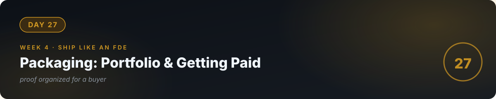

# 💼 Day 27 — Packaging: Portfolio & Getting Paid

**Concept:** Skill without proof is invisible. A **portfolio** is proof organized for a buyer: live URLs, the problem each project solved, the spec you wrote, the evals you ran, the cost model. And **getting paid** is a separate skill: where to find work, how to propose, how to price. Today you package 26 days of work into something that earns.

**Time:** ~60–90 minutes. **Rule:** explain the concept in plain words, or the day doesn't count.

---

## 1. Learn — the concept

### The portfolio that wins work (one page per project)

Each of your 3 projects gets a page with:
1. **Live URL** — clickable, working, stranger-tested.
2. **The problem** — one paragraph, business words not tech words.
3. **What I built** — architecture in one diagram + 3 bullets.
4. **Proof** — eval scores, the honesty test, uptime. Numbers beat adjectives.
5. **Cost model** — "costs $X per 100 uses" — shows you think like an owner.

Build it as a simple site (Streamlit, GitHub Pages, or even a great README). **The portfolio itself is project #4** — it shows everything.

### Where the work is (realistic, day-27 edition)

- **Your network first.** Message 10 people: "I build AI tools for small businesses — here's what I shipped [link]. Know anyone drowning in repetitive questions/paperwork?" Warm intros beat cold applications 10:1.
- **Freelance platforms** (Upwork, local equivalents): start with small fixed-fee AI tasks; your portfolio + evals differentiate you from prompt-jockeys.
- **Local businesses** (day 26's discovery): walk in with the brief template, not a pitch deck.
- **Content**: write up one thing you learned each week (LinkedIn, blog). Teaching in public is a slow-burn client magnet.

### The proposal (keep it to one page)

Problem (their words) → your solution (3 bullets) → scope IN/OUT → timeline → fixed price → proof (your portfolio links). End with **one clear next step**: "Reply yes and I'll send the brief for signature." Friction kills deals.

---

## 2. Specify — direct the AI

> "Help me draft: 1) my portfolio homepage copy — headline, one-line bio, and 3 project summaries in business language (problem → solution → proof), 2) a one-page proposal template I can reuse, with placeholders for problem, scope IN/OUT, timeline, price, and next step, 3) 3 outreach message drafts (network contact, Upwork bid, local business walk-in) — each under 100 words, each ending with one clear next step. Critique each draft for vagueness before finalizing."

## 3. Evaluate — be the senior

- Read your portfolio as a skeptical business owner. Would *you* trust this person with $1,500? What's missing? Fix it.
- **The 10-second test:** show the portfolio to someone for 10 seconds. What do they remember? If it's not "builds AI tools that work," redesign the headline.
- Check every link. Every URL live? Every screenshot current? A dead link in a portfolio is an anti-credential.
- Price yourself on paper: your day rate, your first fixed-fee offer, your walk-away number. Write them down — deciding under pressure is how you undercharge.
- Ask the AI: "Quiz me — what are the 5 parts of a project page? Where does work come from, in priority order? What ends a proposal?"

## 4. Business lens 💼

**This whole day IS the business lens.** The uncomfortable truth: the best engineer doesn't win — the best *packaged* engineer wins. Your 26 days of real skill are the product; today is the packaging, the pricing, and the distribution. Do this day properly and day 30 isn't a hope — it's a pipeline.

---

## 🧠 Quick check — do you own today?

<b>Q1.</b> What's the difference between a project and a portfolio piece?

A project is the thing you built; a portfolio piece is the thing *translated for a buyer* — problem in business words, proof in numbers, live URL, cost model. Translation is the work.

<b>Q2.</b> Why fixed fee over hourly for your first clients?

Hourly punishes speed and rewards slowness — and as an AI-assisted builder you're fast. Fixed fee aligns you with the client's interest (outcome, not hours) and your speed advantage.

<b>Q3.</b> Your portfolio link is dead when a client clicks it. How bad is this?

Catastrophic for trust — it's the one thing that was supposed to prove reliability. Check every link before every outreach. Automate it if you can (a test that pings your URLs).

---

## ✅ Done when

- [ ] Portfolio exists with 3 project pages (problem → solution → proof → cost model)
- [ ] It passes the 10-second test with a real human; all links live
- [ ] Proposal template + 3 outreach drafts written and de-vagued
- [ ] Your rates written down; committed to GitHub

> 🔭 **Coming back to this:** [Phase 4, week 3](../33_Phase4_Get_Paid_Get_Hired/) rebuilds this portfolio as case studies and runs the full job-hunt funnel. Today you packaged your work. There, you'll sell it.

## 📎 The one link

[Patrick McKenzie — "Selling Software to Businesses"](https://www.kalzumeus.com/2011/10/28/dont-call-yourself-a-programmer/) — the classic essay on positioning yourself as a problem-solver, not a coder. Read it twice.

---

[← Day 26](../26_Day_Client_Discovery_FDE/) · [Day 28 →](../28_Day_Capstone_Part1/)
