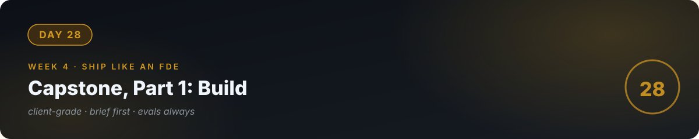

# 🏁 Day 28 — Capstone, Part 1: Build (Client-Grade)



**Concept:** Everything converges. The capstone is a **client-grade AI system** — not a tutorial project, but something you'd defend in front of a paying client: scoped brief, tested reliability, documented limits, honest cost model. Today: the brief and the build. Tomorrow: deploy and harden.

**Time:** 2–3 hours. **Scope:** one system, done properly. **Done when you'd sign your name to it.**

---

## The mission

**Pick ONE** (the smaller the scope, the better the result):

- **A)** A RAG assistant over a real organization's real documents (with their permission) — your day-21 project, rebuilt to client standard.
- **B)** A tool-using assistant for a real workflow (e.g., "quote calculator + FAQ answerer" for a real shop type).
- **C)** Your own choice — but it must have a *real user* in mind, not "users."

---

## Part 1: The brief (30 min, written BEFORE code)

Write `BRIEF.md`:

```markdown
# Capstone Brief
User: [specific person/business type]
Problem: [their words, quantified: hours × people × frequency]
Solution: [3 bullets]
IN scope: [3 bullets] / OUT of scope: [3 bullets]
Success metric: [measurable]
Reliability target: [e.g., 90%+ on 20-case eval set]
Cost ceiling: [max $/100 uses]
Risks: [honest list]
```

**If you can't write this, you don't have a project yet** — you have an idea. Go back to day 26 until the brief is real.

## Part 2: The build (rest of the day)

- [ ] Architecture: API backend (day 24) + RAG or tools (days 17–19) + logging (day 25)
- [ ] Eval set FIRST (day 22): 20 cases written before tuning — this is your contract with yourself
- [ ] Guardrails (day 23): input limits, injection handling, budget cap — all three layers
- [ ] Iterate: build → eval → fix → eval. Log every change and score.
- [ ] The honesty tests: unanswerable questions, injection attempts, bad inputs — all must behave

## The senior review (end of day)

- [ ] Run the full eval set. Score: ___/20. Every failure has a name and a fix-or-document decision.
- [ ] Read BRIEF.md again. Did you build what's IN and avoid what's OUT? (Scope discipline is the grade.)
- [ ] Attack it like day 23. Anything new break?
- [ ] Would you demo this to the user in your brief tomorrow? If not, what's the one thing blocking — fix that first.

---

## 🧠 Check — do you own the standard?

<details>
<summary><b>Q1.</b> What makes this "client-grade" instead of "tutorial-grade"?</summary>

A real user, a written brief with IN/OUT scope, an eval set built before tuning, guardrails, honest limits, and a cost model. Tutorials skip all six; clients pay for all six.
</details>

<details>
<summary><b>Q2.</b> Your eval score is 16/20 and you're tired. Ship or fix?</summary>

Decide with the brief: which 4 failed, and do they touch the success metric? If yes, fix. If they're edge cases outside scope, document them as known limits and ship. "Tired" is not a criterion.
</details>

---

## ✅ Done when

- [ ] BRIEF.md exists and the build matches its IN/OUT
- [ ] 20-case eval set, baseline score logged, failures triaged
- [ ] Guardrails + honesty tests passing
- [ ] Committed to GitHub

---

[← Day 27](../27_Day_Portfolio_Getting_Hired/) · [Day 29 →](../29_Day_Capstone_Part2/)
