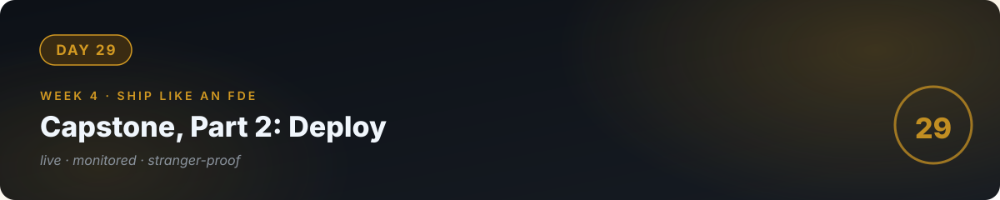

# 🏁 Day 29 — Capstone, Part 2: Deploy & Harden

**Concept:** "Works on my machine" is day 0. **Deployed, monitored, and stranger-proof** is the product. Today your capstone goes live with everything production needs: hosting, secrets, monitoring, runbooks, and a final red-team pass. Tomorrow you demo it.

**Time:** 2–3 hours. **Done when a stranger can break it and it behaves.**

---

## The deployment checklist

### Ship it
- [ ] Deployed to a public URL (Render/Railway/Streamlit Cloud — your day-14 playbook)
- [ ] Secrets in platform env vars, never in code or logs
- [ ] Health endpoint (`GET /health` → `{"status": "ok"}`) so you know it's alive
- [ ] Works in incognito, on mobile, for a stranger

### Harden it
- [ ] Guardrails live and tested *on the deployed URL* (not just locally)
- [ ] Rate limits + daily budget cap configured; alert threshold set
- [ ] Structured logging on; you can trace any request end-to-end
- [ ] RUNBOOK.md deployed alongside (your future self at 2am says thanks)

### Prove it
- [ ] Final eval run on the deployed system — score: ___/20
- [ ] Red-team pass: 10 fresh attacks (injections, huge inputs, rapid-fire). Log results.
- [ ] One real human uses it while you watch silently. Write down every confusion.
- [ ] `/stats` shows real usage data; cost math verified against actual tokens

### Document it
- [ ] Project README: what it is, who it's for, live URL, architecture diagram, eval score, cost model, known limits, runbook link
- [ ] Add it to your portfolio (day 27) as the flagship piece

---

## The pre-demo audit (tonight, honestly)

Answer in writing:

1. What's the eval score, and what are the known failures?
2. What's the cost per 100 uses, measured (not estimated)?
3. What happens when it gets attacked? (Show the logs.)
4. What's explicitly OUT of scope?
5. If the demo gods strike tomorrow (API down, no internet), what's your backup? (Recorded video. Always have a recorded video.)

**A demo with honest limits beats a demo with hidden ones.** Every time.

---

## ✅ Done when

- [ ] Live URL, stranger-tested, mobile-checked
- [ ] Guardrails + budget cap verified on the deployed system
- [ ] Final eval score logged; red-team results logged
- [ ] Portfolio updated; recorded backup video exists
- [ ] Committed to GitHub

---

[← Day 28](../28_Day_Capstone_Part1/) · [Day 30 →](../30_Day_Ship_It/)
