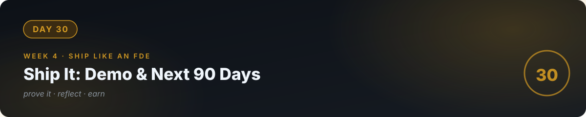

# 🏁 Day 30 — Ship It: Demo, Retrospective & Next 90 Days ⭐



**You made it.** Thirty days ago: zero. Today: three shipped projects, a client-grade capstone with a live URL, evals, guardrails, a cost model, a portfolio, and a business brief template. Today you **prove it, reflect on it, and plan what's next.**

---

## Part 1: The demo (60 min)

**Record a 5-minute demo video** of your capstone:

1. **The problem** (30s) — whose pain, how much it costs them.
2. **The product** (2 min) — live walkthrough, real questions, show the sources panel.
3. **The honesty** (1 min) — ask it something it can't know. Show the "I don't know." Show a blocked injection. *This is your differentiator.*
4. **The engineering** (1 min) — eval score, cost per 100 uses, architecture in one diagram.
5. **The offer** (30s) — "I build systems like this for businesses. Here's my contact."

Post it where your future clients are (LinkedIn, Twitter/X, local business groups). **The demo is your first marketing asset.**

## Part 2: The retrospective (30 min, written)

Answer honestly in `RETROSPECTIVE.md`:

- What are the 3 most important things you learned? (Concepts, not tools.)
- What was the hardest day, and why?
- Where did AI help most? Where did it mislead you?
- What's the weakest part of your capstone? What's the plan to fix it?
- What would you tell yourself on day 1?

## Part 3: The next 60 days — the roadmap (30 min, concrete)

Day 30 was the first finish line, not the last. The [roadmap](../ROADMAP.md) continues to day 90 — three phases, one story:

- **[Phase 2 — Build Like an Engineer (Days 31–50 · Weeks 5–7)](../31_Phase2_Build_Like_An_Engineer/)** — the depth behind everything you built: databases, APIs, testing, git like a team.
- **[Phase 3 — Ship Real Products (Days 51–70 · Weeks 8–10)](../32_Phase3_Ship_Real_Products/)** — one real product with real users, payments, pro deploys, hardened against attack.
- **[Phase 4 — Get Paid & Get Hired (Days 71–90 · Weeks 11–13)](../33_Phase4_Get_Paid_Get_Hired/)** — the interview core, a paid engagement with a contract, the job-hunt funnel.

```markdown
# Next 60 Days
Days 31-50: [Phase 2 — depth; "The Rebuild" of your weakest project]
Days 51-70: [Phase 3 — Product 4 live with real users]
Days 71-90: [Phase 4 — paid engagement + interviews in motion]
The one metric: [e.g., "undeniable" — proof the market responds to]
The one habit: [e.g., "3–5 hours a day; every week ships evidence"]
```

**What changes on day 31:** the pace. Days 1–30 ran on 60–90 minutes a day; days 31–90 need 3–5 hours. That's the honest price of three months, and the roadmap says it out loud. Same iron rule, though: *never ship output you can't explain or defend.*

---

## 🧠 Final check — the whole journey

<details>
<summary><b>Q1.</b> In one sentence each: what do weeks 1, 2, 3, 4 teach?</summary>

Week 1: think like a programmer (concepts). Week 2: think like an engineer (AI writes, you verify). Week 3: the AI engineering core (models, RAG, agents). Week 4: ship like an FDE (production + business).
</details>

<details>
<summary><b>Q2.</b> What's the iron rule of this entire repo?</summary>

Never ship AI output you can't explain or defend. Thirty days of everything else hangs on that sentence.
</details>

<details>
<summary><b>Q3.</b> A business owner asks "why should I trust your AI system?" — your 30-second answer?</summary>

"Here's the live system, here's my eval score on 20 test cases, here's what it costs per use, here's what it refuses to do, and here's what happens when someone attacks it — all logged. Try to break it."
</details>

---

## ✅ Done when

- [ ] 5-minute demo video recorded and posted
- [ ] RETROSPECTIVE.md written honestly
- [ ] Next-90-days plan written with one metric and one habit
- [ ] Final commit; the 30-day tracker fully ticked ✅

---

**Day 1:** "I've never written code."
**Day 30:** "I ship AI software — and I can prove it."
**Day 90:** "I'm a software engineer — and the market knows it."

*Go fix a real problem for a real business — that's what the 30 days were for. Then come back for Phase 2. The next 60 days make you undeniable.* 🚀

---

[← Day 29](../29_Day_Capstone_Part2/) · [Phase 2 →](../31_Phase2_Build_Like_An_Engineer/)
