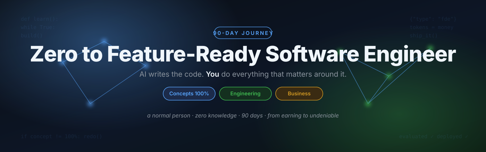
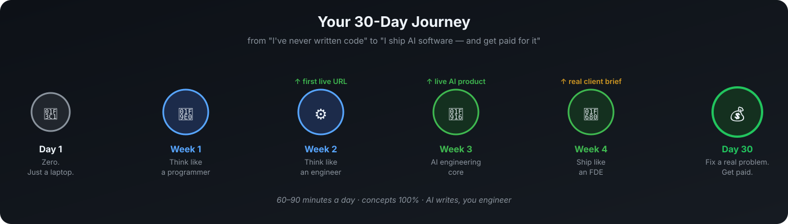

# 🚀 30 Days: Zero to AI Software Engineer

   

**AI writes the code now. This repo teaches what AI can't do for you: concepts, engineering judgment, and business.**

**The promise:** a normal person starting from zero — 30 days later — walks into a business, finds a real problem, fixes it with AI software, and gets paid for it. Learning never stops, but earning starts on day 30.

> 📖 **New here? Read [THE VISION](VISION.md) first.** Two minutes. It's the reason this repo exists — and the reason you'll finish it.

---

## The transformation

| Day 1 | Day 30 |
|---|---|
| "I've never written code." | "I ship AI software." |
| Watches tutorials, learns fragments | Owns concepts 100%, explains them in plain words |
| Afraid of errors | Reads tracebacks like a map |
| "AI is magic" | Directs AI, evaluates its output, stands behind it |
| No proof of skill | 3 deployed projects + 1 capstone, live URLs |
| Can't charge for anything | Can walk into a business, scope a problem, fix it, name a price |

This isn't a course. It's a **30-day transformation with a public record** — your commit history is the proof.

---

## Your journey

## How it works

**⏱ 60–90 minutes a day. 1 day = 1 concept + 1 build + 1 business lens.**

1. **Learn the concept** — one idea, owned 100%. Short lesson + one curated link. Not ten links. One.
2. **Specify it to AI** — you write the specification; AI writes the first draft. Precise specs are now a core engineering skill.
3. **Evaluate like an engineer** — read the AI's code, test it, break it, fix it. *Never ship output you can't explain or defend.*
4. **Business lens** — who pays for this? What does it cost? What breaks in production?
5. **Commit & tick the box** — push your work, then tick the day below. Watch the list fill. Don't break the chain.

### The 3 rules

1. **Concepts 100%, or it doesn't count.** If you can't explain it in plain words, redo the day.
2. **The AI is your junior developer** — fast, confident, sometimes wrong. You are the senior.
3. **A day isn't done until something runs.** Reading doesn't count. Running, tested, committed code counts.

---

## 🗺️ The 30 days — your progress tracker

Fork this repo, then tick each day as you conquer it.

**Week 1 — Think like a programmer** *("the concepts underneath every program ever written")*
- [ ] [Day 01](01_Day_Setup_Learn_With_AI/) — Your toolchain + what a program IS
- [ ] [Day 02](02_Day_Python_Variables_Types/) — Data: types, variables, representation
- [ ] [Day 03](03_Day_Conditionals_Loops/) — Decisions & repetition
- [ ] [Day 04](04_Day_Functions/) — Abstraction: the most important idea in software
- [ ] [Day 05](05_Day_Lists_Dictionaries/) — Collections & structured data
- [ ] [Day 06](06_Day_Files_Errors_Debugging/) — State, persistence & failure
- [ ] [Day 07](07_Day_Project1_CLI_App/) — 🛠 Project 1: scoping & shipping a complete tool

**Week 2 — Think like a software engineer** *("AI writes drafts. Engineers make them trustworthy.")*
- [ ] [Day 08](08_Day_Git_GitHub/) — Version control: time travel for software
- [ ] [Day 09](09_Day_HTTP_APIs_JSON/) — How the internet works: programs talking to programs
- [ ] [Day 10](10_Day_Environments_Packages/) — Reproducibility: "works on my machine" is a bug
- [ ] [Day 11](11_Day_OOP_Essentials/) — Modeling reality: objects (just enough)
- [ ] [Day 12](12_Day_Testing_Clean_Code/) — Trust: testing & reading code like an engineer
- [ ] [Day 13](13_Day_First_Web_App/) — Interfaces: logic humans can use
- [ ] [Day 14](14_Day_Project2_Deployed_Web_App/) — 🛠 Project 2: your first live URL

**Week 3 — AI engineering core** *("how the magic actually works")*
- [ ] [Day 15](15_Day_LLMs_How_They_Work/) — How LLMs actually work: tokens, context, cost
- [ ] [Day 16](16_Day_Prompt_Engineering/) — Specification: prompts as engineering
- [ ] [Day 17](17_Day_Structured_Outputs_Tools/) — Connecting models to code: tools
- [ ] [Day 18](18_Day_Embeddings_Semantic_Search/) — Meaning as math: embeddings
- [ ] [Day 19](19_Day_RAG/) — RAG: grounding AI in real documents
- [ ] [Day 20](20_Day_Agents/) — Agents: goals, tools & the perceive–act loop
- [ ] [Day 21](21_Day_Project3_RAG_Chatbot/) — 🛠 Project 3: a live AI product

**Week 4 — Ship like a Forward Deployed Engineer** *("where engineering meets business")*
- [ ] [Day 22](22_Day_Evals/) — Proof: evaluating AI systems
- [ ] [Day 23](23_Day_Guardrails_Cost/) — Production reality: safety, attacks & cost
- [ ] [Day 24](24_Day_FastAPI_Databases/) — Backends: APIs & persistence
- [ ] [Day 25](25_Day_Observability_Debugging/) — Operations: logging, tracing & runbooks
- [ ] [Day 26](26_Day_Client_Discovery_FDE/) — 💼 Discovery: turning human problems into specs
- [ ] [Day 27](27_Day_Portfolio_Getting_Hired/) — 💼 Packaging: portfolio & getting paid
- [ ] [Day 28](28_Day_Capstone_Part1/) — 🏁 Capstone: build a client-grade AI system
- [ ] [Day 29](29_Day_Capstone_Part2/) — 🏁 Capstone: deploy it live
- [ ] [Day 30](30_Day_Ship_It/) — 💼 Ship it: demo, retrospective, next 90 days

📖 **[Full day-by-day curriculum with objectives, builds and exercises →](CURRICULUM.md)**

---

## 🗺️ Finished day 30? The road continues — days 31–180

**From "I ship AI software" to "I'm a complete, hire-ready software engineer."** Five phases, week by week — everything the 30 days didn't cover: deep engineering, real products with real users, computer science for interviews, professional work, and getting hired.

- [ ] [Phase 2 — Go Deep (Days 31–60)](31_Phase2_Go_Deep/) — Databases, APIs, testing, git like a team
- [ ] [Phase 3 — Build Real Things (Days 61–90)](32_Phase3_Build_Real_Things/) — Real users, payments, DevOps basics, open-source PR
- [ ] [Phase 4 — Think Like a Computer (Days 91–120)](33_Phase4_Think_Like_A_Computer/) — Algorithms, systems, the interview-proof core
- [ ] [Phase 5 — Work Like a Professional (Days 121–150)](34_Phase5_Work_Like_A_Professional/) — Security, teams, clients, teaching
- [ ] [Phase 6 — Get Hired (Days 151–180)](35_Phase6_Get_Hired/) — Portfolio, interview prep, the job-hunt funnel

📖 **[Full roadmap: what "feature-ready" means and the 180-day map →](ROADMAP.md)**

---

## 🧠 Try it right now — no setup needed

<b>Quick check: do you think like an engineer yet?</b> (click to open)

 

**Q1.** A program prints `22` when you expected `4`. What's the *first* question you ask?

Reveal answer

"What type is this data, really?" — it's almost certainly `"2" + "2"` (text) instead of `2 + 2` (numbers). That's Day 2, and it explains half of all beginner bugs.

 

**Q2.** Your AI assistant wrote 50 lines that work. What's your job now?

Reveal answer

Evaluate: read it, test the edges, try to break it, and make sure you can explain every part. AI writes the draft — you stand behind it. That's the whole repo in one sentence.

 

**Q3.** A shop owner says "I need software." What's your first move?

Reveal answer

Not code — questions. What problem? Who has it? What does it cost them today? That's discovery (Day 26), and it's the most valuable skill here.

---

## What "AI Forward Deployed Engineer" means

The person who shows up where the problem lives. Not generating code in isolation — understanding a client's problem, designing the right system, directing AI to build it, verifying it works, deploying it, standing behind it. **Judgment + engineering + business.**

## Tools (all free)

Python 3.11+, VS Code, Git + GitHub, one AI coding assistant (Claude Code / ChatGPT / Cursor / Copilot), one LLM API key with free credits, Streamlit Cloud / Render free tier. Day 1 sets it all up.

## Repos that inspired this

[Asabeneh/30-Days-Of-Python](https://github.com/Asabeneh/30-Days-Of-Python) · [Asabeneh/30-Days-Of-JavaScript](https://github.com/Asabeneh/30-Days-Of-JavaScript) · [razaqfatiu/30days-of-GenAI](https://github.com/razaqfatiu/30days-of-GenAI) · [najmal-ibrahim/30-days-of-ai](https://github.com/najmal-ibrahim/30-days-of-ai) · [abhishekyadav2000/ai-engineering-from-scratch](https://github.com/abhishekyadav2000/ai-engineering-from-scratch) · [microsoft/AI-For-Beginners](https://github.com/microsoft/AI-For-Beginners)

What this repo adds: **concepts-first in the AI era, engineering judgment over typing, business from day one** — for people who will direct AI, not compete with it.

## Contributing

Found a broken link, a clearer explanation, a better free resource? [CONTRIBUTING.md](CONTRIBUTING.md). PRs welcome.

## License

MIT — learn from it, fork it, teach with it.
