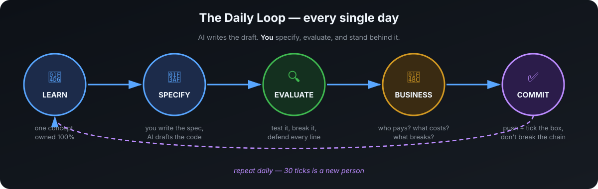

# FDE Academy — Software and AI Engineering

   

**Designed for learners starting in 2028 or 2029.** Master software and AI concepts, direct capable AI systems, and deliver useful products. AI can produce all implementation code; the learner demonstrates understanding and successful outcomes. Read [the accepted roadmap and thirty missions](ROADMAP.md). The app now implements this sequence, with separate product and understanding records. Beginner pilots, pacing and practitioner calibration remain to be measured.

Read the [2030 research and scenarios](RESEARCH-2030.md) for the evidence behind this direction and the additional preparation needed for changing work, stronger automation, and everyday life with AI.

## Interactive FDE Academy

Choose **Start mission 1**. Build a useful service website with AI, understand its actual technologies, then grow towards connected systems and an independent domain project.

The default core has **six stages and thirty missions**. Each mission contains a concrete problem, concept explanations, a worked example, an immediate interactive simulation, an AI-directed project, outcome checks and separate understanding prompts. Manual coding is optional. AI can plan, implement, test, diagnose and help review throughout.

The [interactive learning studio](INTERACTIVE-STUDIO.md) lets you edit inputs and inspect calculated consequences in every core mission. Try the real page in Mission 1, then explore system roles in 3D or an equivalent flat diagram. Experiments and notes resume in your browser; every project kit includes its own experiment guide.

All thirty missions now lead with a real page or concept-specific visual evidence: receipts, record cards, cost curves, request steps, permission gates, structured-output checks, trace timelines, cache routes and composable capabilities. Diagram actions update the same saved experiment controls. See [the coverage map and verification boundaries](LESSON-VISUALS.md).

Each lesson also has a short situation, two guided comparisons that change one control, reversible input edits and a worked example revealed one moment at a time. See [the learning flow](LEARNING-PACING.md). All thirty project kits include both comparison guides.

In **Mission 18 → Understand**, [teach a small model](NEURAL-LEARNING.md): move an input, change a connection, run real training updates and check separate examples. The live map, connection diagram and loss curve show the same calculation. Its guide and model source travel in Mission 18's kit.

In **Mission 1 → Understand**, [keep learning with the page you changed](PAGE-UNDERSTANDING.md): hide an information line, change colour independently, then explore content, appearance and actual click behaviour. These controls share saved values with Explore and lead into the existing project. The guide is included in Mission 1's kit.

In **Mission 4 → Understand**, [follow the estimator's logic](LOGIC-UNDERSTANDING.md): compare blank with zero, inspect the checks that actually run, then separate editing input from calling a function and remembering its result. The guide and model source travel in Mission 4's kit.

All **30 core lessons** now share the [illustrated scene experience](ALL-LESSON-SCENES.md): dark teal stages, warm gold actions, immediate visual consequences and a direct route to each lesson's actual project. Two browser-page scenes, the repair visit and twenty-seven model-specific illustrations teach different ideas. Every kit includes its own scene guide.

In **Mission 26 → Explore**, [get a repair visit moving](ACCESS-JOURNEY.md): try a faster preparation time, see the van remain at its workshop, then change the access prerequisite. The finite illustrated sequence supports pause/replay and reduced motion, using the same saved workflow model.

The [illustrated academy journey](ACADEMY-DESIGN.md) connects the homepage, six chapters and core lessons. Edit a real page before starting, carry that heading into Mission 1, and see the experiment and project behind each mission. The reservation and AI evaluation lessons also expose individual operations and cases behind their totals.

Every project requires an eight-part system explanation: purpose, actual stack, component roles, choices, execution, action flow, information/access/AI, and changes/failures. A reviewer checks explanations, predictions and fresh scenarios rather than accepting generated prose alone.

Read [the core learning flow](MISSION-COURSE.md), [all thirty mission guides and reuse map](MISSION-MAP.md), and [the research and scenarios](RESEARCH-2030.md). The first five kits contain a runnable static example; every mission has its own project brief and evidence kit. Simulations and fixtures are labelled and cannot establish live AI quality or real customer benefit.

The [original coding workshops and projects](PROJECTS.md), practice lab, field scenarios, portfolio and saved records remain available. Amina's [guided examples](GUIDED-COURSE.md) and [shop workspace](guided-projects/shop-workspace/README.md) remain optional resources. Old progress does not complete new missions.

```bash
cd web
npm ci
npm run dev
```

Read the [app setup and publishing guide](web/README.md). Thirty missions define a sequence, not thirty days of guaranteed readiness. Passing app checks does not establish learning outcomes, employment or equivalence to years of experience.

---

**Concepts are compulsory. AI can perform all implementation.** Understand what the system does, why its parts work together, and how to establish that it meets the user's needs.

**The aim:** develop conceptual understanding and the ability to deliver through AI. Practise problem definition, delegation, evaluation, diagnosis, and improvement with AI available throughout. Lesson numbers describe an order, not a deadline.

**Readiness evidence:** explain what you are building, identify its actual technologies and their roles, describe why they were chosen, and trace how the system works from a user action to the result. Every project includes this explanation. A reviewer checks conceptual understanding through a walkthrough and changed scenarios, alongside useful behaviour demonstrated with AI. Completion alone does not guarantee employment or income.

> 📖 **New here? Read [THE VISION](VISION.md) first.** Two minutes. It's the reason this repo exists — and the reason you'll finish it.

---

## The transformation

| Starting out | Foundation practice | Evidence of readiness |
|---|---|---|
| Learning the first concepts | Builds with AI and explains the major parts | Applies the concepts to an unfamiliar request |
| Needs worked examples | Predicts behaviour and investigates with AI | Directs changes and explains the resulting evidence |
| Learning what AI can do | Delegates implementation and evaluates results | Uses stronger tools to solve more demanding problems |
| No delivery evidence yet | Records products, decisions, and observations | Shows useful outcomes, feedback, and successful maintenance |

Progress combines conceptual explanations, predictions, decisions, working products, and observed results. AI can perform the technical work throughout; a reviewer assesses the learner's understanding and ability to deliver.

---

## Your journey

**The existing 30 workshops are reusable learning material.** [MISSION-MAP.md](MISSION-MAP.md) records their mapping into the implemented core. Day numbers below describe the optional original order.

**The six core stages:** build with AI → understand and design the problem → understand the complete system → direct AI work at scale → establish quality and operate → deliver value. Every stage includes compulsory concepts. The [roadmap](ROADMAP.md) lists all thirty missions and their evidence; pilots will establish realistic pacing.

## How it works

**Use a sustainable study session.** Understand an idea, predict an outcome, direct AI work, and explain what the result shows. Deeper concepts and projects require repeated sessions.

1. **Understand the concept** — use an example, diagram, or experiment; explain it and predict a variation.
2. **Define the outcome** — describe the user, required behaviour, constraints, and what success looks like.
3. **Direct AI** — let it research, plan, implement, test, or diagnose with appropriate context and authority.
4. **Establish the result** — compare observations with the requirement and direct improvements where needed.
5. **Explain and record** — describe the important concepts, decisions, evidence, and remaining gaps.



### The 3 rules

1. **Demonstrate understanding.** Explain the behaviour and solve a different version with less help.
2. **Use AI fully and thoughtfully.** Delegate implementation, understand its role, and establish the required result.
3. **Build evidence over time.** Running code, meaningful tests, feedback, and maintenance all contribute.

---

## Optional original workshops — your practice tracker

The core path is indexed in [MISSION-MAP.md](MISSION-MAP.md). The original workshops below retain implementation exercises and their historical schedules; those manual-coding and line-by-line requirements do not apply to core graduation.

**Week 1 — Think like a programmer** *("the concepts underneath every program ever written")*
- [ ] [Day 01](01_Day_Setup_Learn_With_AI/) — Your toolchain + what a program IS
- [ ] [Day 02](02_Day_Python_Variables_Types/) — Data: types, variables, representation
- [ ] [Day 03](03_Day_Conditionals_Loops/) — Decisions & repetition
- [ ] [Day 04](04_Day_Functions/) — Abstraction: the most important idea in software
- [ ] [Day 05](05_Day_Lists_Dictionaries/) — Collections & structured data
- [ ] [Day 06](06_Day_Files_Errors_Debugging/) — State, persistence & failure
- [ ] [Day 07](07_Day_Project1_CLI_App/) — 🛠 Project 1: scoping & shipping a complete tool

**Week 2 — Think like a software engineer** *("AI writes drafts. Engineers make them trustworthy.")*
- [ ] [Day 08](08_Day_Git_GitHub/) — Version control: time travel for software
- [ ] [Day 09](09_Day_HTTP_APIs_JSON/) — How the internet works: programs talking to programs
- [ ] [Day 10](10_Day_Environments_Packages/) — Reproducibility: "works on my machine" is a bug
- [ ] [Day 11](11_Day_OOP_Essentials/) — Modeling reality: objects (just enough)
- [ ] [Day 12](12_Day_Testing_Clean_Code/) — Trust: testing & reading code like an engineer
- [ ] [Day 13](13_Day_First_Web_App/) — Interfaces: logic humans can use
- [ ] [Day 14](14_Day_Project2_Deployed_Web_App/) — 🛠 Project 2: your first live URL

**Week 3 — AI engineering core** *("how the magic actually works")*
- [ ] [Day 15](15_Day_LLMs_How_They_Work/) — How LLMs actually work: tokens, context, cost
- [ ] [Day 16](16_Day_Prompt_Engineering/) — Specification: prompts as engineering
- [ ] [Day 17](17_Day_Structured_Outputs_Tools/) — Connecting models to code: tools
- [ ] [Day 18](18_Day_Embeddings_Semantic_Search/) — Meaning as math: embeddings
- [ ] [Day 19](19_Day_RAG/) — RAG: grounding AI in real documents
- [ ] [Day 20](20_Day_Agents/) — Agents: goals, tools & the perceive–act loop
- [ ] [Day 21](21_Day_Project3_RAG_Chatbot/) — 🛠 Project 3: a live AI product

**Week 4 — Ship like a Forward Deployed Engineer** *("where engineering meets business")*
- [ ] [Day 22](22_Day_Evals/) — Proof: evaluating AI systems
- [ ] [Day 23](23_Day_Guardrails_Cost/) — Production reality: safety, attacks & cost
- [ ] [Day 24](24_Day_FastAPI_Databases/) — Backends: APIs & persistence
- [ ] [Day 25](25_Day_Observability_Debugging/) — Operations: logging, tracing & runbooks
- [ ] [Day 26](26_Day_Client_Discovery_FDE/) — 💼 Discovery: turning human problems into specs
- [ ] [Day 27](27_Day_Portfolio_Getting_Hired/) — 💼 Packaging: portfolio & getting paid
- [ ] [Day 28](28_Day_Capstone_Part1/) — 🏁 Capstone: build a client-grade AI system
- [ ] [Day 29](29_Day_Capstone_Part2/) — 🏁 Capstone: deploy it live
- [ ] [Day 30](30_Day_Ship_It/) — 💼 Ship it: demo, retrospective, next 90 days

📖 **[Full day-by-day curriculum with objectives, builds and exercises →](CURRICULUM.md)**

---

## Continue beyond the initial lessons

Follow the [proposed roadmap](ROADMAP.md) for the complete concept foundation and thirty missions in AI-led delivery. The original extension outlines below are reusable source material; their compressed schedules and any compulsory manual implementation expectations are superseded by the new direction.

- [ ] [Phase 2 — Build Like an Engineer (Days 31–50 · Weeks 5–7)](31_Phase2_Build_Like_An_Engineer/) — Databases, APIs done right, testing, git like a team
- [ ] [Phase 3 — Ship Real Products (Days 51–70 · Weeks 8–10)](32_Phase3_Ship_Real_Products/) — Real users, payments, pro deploys, security, open-source PR
- [ ] [Phase 4 — Get Paid & Get Hired (Days 71–90 · Weeks 11–13)](33_Phase4_Get_Paid_Get_Hired/) — Interview-proof core, paid engagement, the job-hunt funnel

📖 **[Full roadmap: competencies, assessments, and relevance for 2028–2029 →](ROADMAP.md)**

---

## 🧠 Try it right now — no setup needed

<details>
<summary><b>Quick check: do you think like an engineer yet?</b> (click to open)</summary>

<br>

**Q1.** A program prints `22` when you expected `4`. What's the *first* question you ask?

<details>
<summary>Reveal answer</summary>

"What type is this data, really?" — it's almost certainly `"2" + "2"` (text) instead of `2 + 2` (numbers). That's Day 2, and it explains half of all beginner bugs.
</details>

<br>

**Q2.** Your AI assistant wrote 50 lines that work. What's your job now?

<details>
<summary>Reveal answer</summary>

Establish that it does what was requested. Ask AI to help test the relevant behaviour, inspect the observed results, and explain the important concepts and decisions. Use a changed scenario to check your understanding.
</details>

<br>

**Q3.** A shop owner says "I need software." What's your first move?

<details>
<summary>Reveal answer</summary>

Not code — questions. What problem? Who has it? What does it cost them today? That's discovery (Day 26), and it's the most valuable skill here.
</details>

</details>

---

## What "AI Forward Deployed Engineer" means

The person who shows up where the problem lives. Not generating code in isolation — understanding a client's problem, designing the right system, directing AI to build it, verifying it works, deploying it, standing behind it. **Judgment + engineering + business.**

## Tools

The current course uses Python, Git, an editor, web tools, and AI examples. Check each lesson's setup for supported versions and practice modes. Live models and hosting may incur costs. The proposed curriculum keeps provider and setup instructions replaceable so future learners can use supported tools.

## Repos that inspired this

[Asabeneh/30-Days-Of-Python](https://github.com/Asabeneh/30-Days-Of-Python) · [Asabeneh/30-Days-Of-JavaScript](https://github.com/Asabeneh/30-Days-Of-JavaScript) · [razaqfatiu/30days-of-GenAI](https://github.com/razaqfatiu/30days-of-GenAI) · [najmal-ibrahim/30-days-of-ai](https://github.com/najmal-ibrahim/30-days-of-ai) · [abhishekyadav2000/ai-engineering-from-scratch](https://github.com/abhishekyadav2000/ai-engineering-from-scratch) · [microsoft/AI-For-Beginners](https://github.com/microsoft/AI-For-Beginners)

What this repo develops: conceptual understanding, effective AI direction, and the ability to connect software to users' needs.

## Contributing

Found a broken link, a clearer explanation, a better free resource? [CONTRIBUTING.md](CONTRIBUTING.md). PRs welcome.

## License

MIT — learn from it, fork it, teach with it.
