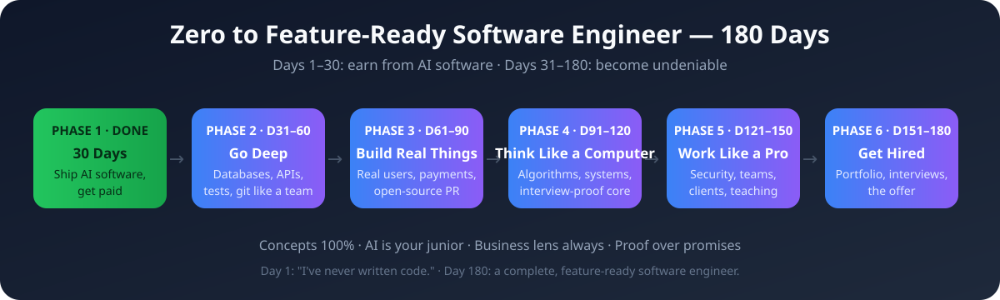

# 🗺️ The Complete Software Engineering Roadmap — Days 31–180

**Days 1–30 taught you to earn from AI software. Days 31–180 make you undeniable.** Five phases, week by week, that turn a 30-day builder into a complete, hire-ready software engineer.

---

## What "feature-ready software engineer" actually means

Not a certificate. Not a tutorial count. A person who can do all of this:

- [ ] Build a full product end to end — frontend, API, database, deployed, with real users
- [ ] Explain every line they ship, in plain words
- [ ] Write tests that catch real breakage, and a CI pipeline that runs them
- [ ] Design a database that won't collapse, with migrations
- [ ] Design a clean API strangers can use from docs alone
- [ ] Debug production: read logs, trace a request, find the slow part
- [ ] Keep secrets secret; name the likely attacks on their app and the defenses
- [ ] Read a big unfamiliar codebase and become useful in it within days
- [ ] Reason about cost growth (Big-O) and defend a system design out loud
- [ ] Work in a team: branches, PRs, code review given and received
- [ ] Scope client work, write a contract, name a price, get a testimonial
- [ ] Write docs and tutorials strangers find useful
- [ ] Present their work as case studies; survive interviews; negotiate an offer

If you can tick every box, you're not "learning to code" anymore. You're a software engineer.

---

## The map

| Phase | Days | The shift | The proof |
|---|---|---|---|
| [1 — The 30 days](30_Day_Ship_It/) | 1–30 | Zero → ships AI software, gets paid | 3 projects + capstone, live |
| [2 — Go Deep](31_Phase2_Go_Deep/) | 31–60 | "It works" → "I know exactly why" | The Rebuild: Postgres + tests + clean API |
| [3 — Build Real Things](32_Phase3_Build_Real_Things/) | 61–90 | Builder → evidence | Project 4 with real users + merged open-source PR |
| [4 — Think Like a Computer](33_Phase4_Think_Like_A_Computer/) | 91–120 | Coder → reasoner | The Interview Pack: 40 problems + 3 design docs |
| [5 — Work Like a Professional](34_Phase5_Work_Like_A_Professional/) | 121–150 | Coder → trusted professional | Security audit + paid engagement + public tutorial |
| [6 — Get Hired](35_Phase6_Get_Hired/) | 151–180 | Proof → paycheck | Portfolio + interviews in motion |

---

## How the daily loop evolves

Days 1–30 ran on **60–90 minutes a day**: one concept, one build, one business lens. That loop still works — but the phases ask for more:

- **Phases 2–3:** 2–3 hours a day. Depth and real projects need longer sessions.
- **Phases 4–5:** 2–4 hours a day. Problem-solving and client work don't fit in 60 minutes.
- **Phase 6:** the job hunt IS the work. Applications, mocks, conversations — scheduled like a job.

The iron rule never changes: **never ship output you can't explain or defend.** It carried you through 30 days; it carries you through 180.

---

## Honest expectations

- **This is a 6-month path, not a shortcut.** Anyone selling "senior engineer in 90 days" is selling something.
- **The job hunt is part of the curriculum** (Phase 6), not something that happens after it. Hiring takes 2–3 months by itself.
- **Freelancing and employment are parallel paths**, not sequential. A retainer client in Phase 5 is income AND proof.
- **You will feel behind at day 90.** Everyone does. The map is the antidote — follow it, tick the boxes, trust the process.
- **AI stays your junior developer the whole way.** The further you go, the more your value is judgment, not typing.

---

## The one link

[roadmap.sh](https://roadmap.sh) — the community's living map of everything a developer can learn. Use it as a reference when you want to see where a topic sits in the bigger picture. Your phases here are the guided path through it.

---

*Day 1: "I've never written code." Day 180: a complete software engineer — with the repos, the clients, and the judgment to prove it.*
